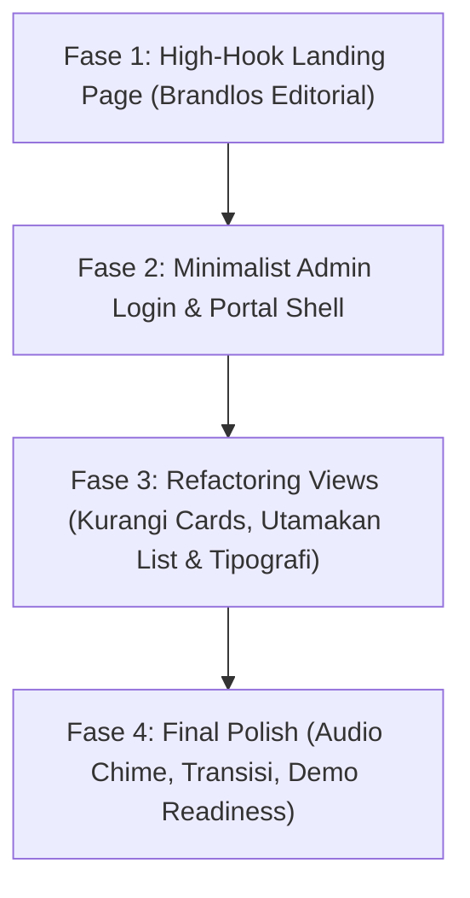

# Plan: Polish & Anti "AI Slop" Transformation
## Smart Clinic Management System

Dokumen ini adalah cetak biru teknis dan eksekusi untuk mengubah aplikasi klinik dari purwarupa saat ini menjadi produk premium berkelas agensi (mengacu pada estetika **Brandlos / Nordic Modern**). Dokumen ini dirancang agar dapat dieksekusi secara mandiri oleh AI Agent maupun pengembang manusia.

---

## 1. Evaluasi & Mengapa UI Saat Ini Masih Terasa "AI Slop"

| Gejala AI Slop (Yang Harus Dibuang) | Solusi Anti-Slop (Brandlos Standard) |
| :--- | :--- |
| **Kebanyakan Card (`Card-Hell`):** Setiap elemen data dibungkus dalam kotak putih dengan border & shadow berulang. | **Typographic Hierarchy on Canvas:** Biarkan teks dan angka besar bernapas langsung di atas canvas hangat (`#F9F9F7`). Gunakan hairline border halus (`border-black/5`) hanya jika benar-benar memisahkan konteks utama. |
| **Grid Seragam 3–4 Kolom Membosankan:** Kotak-kotak kecil dengan ikon berwarna-warni di pojok kiri atas. | **Asymmetric & Editorial Layout:** Layout dinamis seperti web majalah/agensi. Headline raksasa, kontras tegas, dan whitespace lapang. |
| **Tidak Ada "Hook" Pasien:** Masuk langsung disodori form input yang dingin. | **High-Hook Landing Page:** Sapaan berani, counter antrian live, dan *call to action* yang menyelesaikan keresahan pasien dalam 1 kali pandang. |
| **Tanpa Gerbang Login:** Semua orang langsung melihat seluruh tombol navigasi staf. | **Minimalist Staff Auth Portal:** Layar login elegan tanpa ilustrasi 3D kartun generik, dilengkapi demo quick-switch 1-klik untuk presentasi. |

---

## 2. Roadmap Pengerjaan Bertahap



---

### FASE 1: High-Hook Landing Page (`LandingPage.vue`)
**Tujuan:** Pasien dan klien klinik yang membuka link langsung terpukau dengan value proposition yang kuat, modern, dan tidak kaku.

* **Struktur Halaman:**
  1. **Navbar Minimal:** Logo teks klinik tebal (`font-extrabold text-xl`), jam operasional live, dan tombol *"Portal Staf"*.
  2. **Hero Section (Asymmetric Brandlos Style):**
     * Tagline Besar: *"Bukan antri biasa. Berobat tanpa ribet chat WA."*
     * Subheadline editorial: Menjelaskan bahwa nomor antrian terbit otomatis dan status obat terpantau live.
     * **Interactive Live Ticket Hook:** Widget ringkas langsung di hero untuk ambil antrian atau cek nomor antrian berjalan hari ini.
  3. **3 Nilai Kunci (Bukan Card, tapi Editorial Rows):**
     * *01 / Tanpa Disposisi Kertas:* Resep dokter langsung masuk layar apoteker.
     * *02 / Transparan & Single Invoice:* 1 struk lunas tanpa hitungan berbelit.
     * *03 / Terintegrasi SATUSEHAT:* Standar regulasi resmi Kementerian Kesehatan RI.
  4. **Direct Action Footer:** Tombol besar melengkung penuh (*pill button*) untuk pendaftaran pasien mandiri.

---

### FASE 2: Staff Authentication & Unified Admin Shell (`LoginView.vue` + `AdminPortal.vue`)
**Tujuan:** Memberikan gerbang profesional untuk staf (Kasir, Dokter, Apoteker, Pimpinan) tanpa template dashboard generik.

* **Layar Login (`LoginView.vue`):**
  * Desain monokromatik hangat: Tipografi bold, input garis minimalis tanpa border tebal.
  * **Fitur Pitching (Quick Role Login):** 4 pill tombol untuk demo instan tanpa perlu ketik password:
    * `[Masuk sebagai Dokter]`
    * `[Masuk sebagai Apoteker]`
    * `[Masuk sebagai Kasir / Pendaftaran]`
    * `[Masuk sebagai Direktur / Keuangan]`
* **Admin Layout (`AdminPortal.vue`):**
  * Membuang navbar demo melayang yang terasa seperti mainan.
  * Menggunakan **Sleek Top Masthead** atau **Slim Minimal Sidebar**:
    * Menampilkan role aktif staf, indikator status server lokal, dan tombol keluar.
    * Mengganti kartu-kartu kecil menjadi **Data Dense Workstation** yang ergonomis untuk kerja cepat.

---

### FASE 3: Refactoring Views (Kurangi Card, Perkuat Tipografi & List)
**Tujuan:** Mengeliminasi "card-hell" pada layar operasional staf.

#### A. Ruang Dokter (`DoctorRoom.vue`)
* **Ubah:** Buang card terpisah-pisah untuk NIK, nama, dan keluhan.
* **Terapkan:** 1 bidang kerja terpadu split-view:
  * Kolom Kiri (Daftar Antrian): Clean typographic list dengan nomor antrian bold dan status dot.
  * Kolom Kanan (Pemeriksaan & E-Resep): Formulir rekam medis beralur vertikal alami tanpa dibungkus kotak-kotak kecil berlapis.

#### B. Farmasi / Apotek (`PharmacyRoom.vue`)
* **Ubah:** Jangan gunakan card grid bertumpuk untuk setiap resep.
* **Terapkan:** **Table/Timeline View Berbasis Urutan Masuk:**
  * Baris resep lapang dengan aksi langsung (*Checklist Racik ➔ 1-Klik Serahkan*).
  * Indikator reservasi stok yang menyatu rapi di teks tanpa badge warna-warni berlebihan.

#### C. Gudang Stok Obat (`InventoryView.vue`)
* **Ubah:** Hapus 3 kartu stat warna-warni di bagian atas.
* **Terapkan:** 
  * Ringkasan stok dalam format tipografi garis (*single-line metrics*):  
    `Stok Aktif: 707 Unit • Dipesan: 0 • Mendekati ED: 1 Batch • Menipis: 1 Item`
  * Tabel inventori monokrom bersih dengan indikator warna hanya pada item kritis (ED < 3 bulan).

#### D. Billing & Invoice (`BillingView.vue`)
* **Terapkan:** Tampilan invoice satu lembar otentik bergaya struk formal minimalis, bukan mockup kartu floating.

---

### FASE 4: Micro-Interactions & Polishing Terakhir
1. **Pemberitahuan Halus:** Notifikasi sukses berupa toast melayang tipis di sudut bawah, bukan banner alert raksasa di atas konten.
2. **Animasi Transisi Halaman:** Vue `<Transition>` 150ms dengan kurva bezier halus (`cubic-bezier(0.16, 1, 0.3, 1)`).
3. **Sound Chime:** Suara lonceng lembut Web Audio API saat apotek menerima e-resep baru dari dokter.

---

## 3. Rincian File yang Akan Dimodifikasi / Dibuat

```text
frontend/src/
├── views/
│   ├── LandingPage.vue        # [BARU] Landing page berdaya tarik tinggi (Brandlos style)
│   ├── LoginView.vue          # [BARU] Minimalist staff login dengan 1-click role picker
│   ├── AdminPortal.vue        # [BARU] Container admin shell terpadu pengganti floating pill
│   ├── PatientKiosk.vue       # [REFACTOR] Khusus tampilan mobile mandiri pasien
│   ├── DoctorRoom.vue         # [REFACTOR] Eliminasi card-hell, split-pane ergonomis
│   ├── PharmacyRoom.vue       # [REFACTOR] Order timeline view bersih
│   ├── InventoryView.vue      # [REFACTOR] Single-line metric strip & table minimalis
│   └── BillingView.vue        # [REFACTOR] Struk cetak formal & audit report
├── components/
│   ├── Navbar.vue             # [BARU] Header minimalis untuk landing page
│   └── AdminHeader.vue        # [BARU] Masthead navigasi staf klinik
└── App.vue                    # Router state switcher (Landing vs Kiosk vs Admin)
```

---

## 4. Kriteria Keberhasilan (Definition of Done)
1. **Tidak Ada "Card-Hell":** Tidak ada lagi layar yang memuat lebih dari 3 kotak berborder tanpa alasan fungsional yang kuat.
2. **Kesan Pertama (Landing Page):** Begitu web dibuka, langsung tampil headline berani dan atraktif khas agensi modern, bukan form isian mentah.
3. **Alur Staf Jelas:** Dokter dan apoteker masuk melalui portal staf, bukan tombol demo melayang yang menutupi konten.
4. **Performa & Responsivitas:** Halaman pasien ramah smartphone 100%, halaman staf optimal untuk laptop/desktop kasir.
