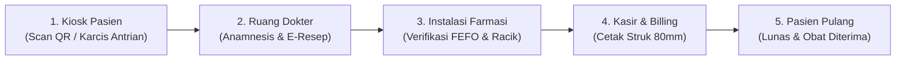

# 🏥 Klinik Sehat Modern (Smart Clinic OS)

> **Sistem Informasi Manajemen Klinik Mandiri (SIMKlinik Pratama & Apotek Terpadu)**  
> Dibangun dengan arsitektur **Modular Monolith (Go + SQLite)** dan antarmuka web modern berestetika **Brandlos / Nordic Modern (Vue 3 + Tailwind CSS)**. Siap akreditasi Kemenkes RI & operasional harian.

---

## 🌟 Nilai Utama (*Key Highlights*)

* **End-to-End Patient Journey:** Alur pelayanan terpadu tanpa kertas dari loket pendaftaran mandiri (*Kiosk*), ruang periksa dokter (*E-Resep*), instalasi farmasi (*Apotek FEFO*), kasir pembayaran (*Billing*), hingga pergudangan obat.
* **Invarian Stok Obat Ketat (Anti-Selisih):** Rumus stok terjamin aman: `Tersedia = Fisik - Reserved`. Saat dokter meresepkan, obat langsung di-*reserve* otomatis sehingga tidak bisa diserobot resep lain.
* **Pengeluaran Obat Berbasis FEFO (*First Expired, First Out*):** Apotek otomatis memprioritaskan batch obat yang paling mendekati tanggal kedaluwarsa untuk meminimalkan kerugian obat kedaluwarsa.
* **Pemisahan Transaksi Resmi (*Split Invoicing*):**
  * `INV-REG-...`: Tagihan Karcis Pendaftaran & Antrian (Rp 35.000) yang dibayar di awal.
  * `INV-FAR-...`: Tagihan Tebus Resep Obat Apotek dengan daftar obat *itemized*.
* **Struk Kasir Tradisional (80mm Thermal Receipt):** Dilengkapi format cetak fisik POS roll 80mm via `@media print` murni (font monospace, garis putus-putus, stempel `*** LUNAS ***`, dan barcode simulasi), sementara tampilan layar tetap bergaya web modern.
* **Audit Keuangan Internal Otomatis:** Memisahkan bagi hasil jasa dokter (70%), margin sarana klinik, dan PPN 11% secara otomatis tanpa kalkulasi manual.
* **Kesiapan Regulasi Kemenkes (SatuSehat Ready):** Dilengkapi pemetaan kode KFA (*Katalog Farmasi & Alat Kesehatan*) dan mock generator payload FHIR R4 (*Encounter & Medication*).
* **Desain Anti "AI Slop":** Estetika minimalis Nordic di atas kanvas hangat (`#F9F9F7`), tipografi editorial berani, tanpa tumpukan kotak berlebih (*anti card-hell*), dan transisi tombol *snappy*.

---

## 🧭 Alur Pelayanan Pasien (*The Patient Flow*)



1. **Pasien Datang & Kiosk Mandiri:** Pasien memasukkan NIK dan keluhan di HP/kiosk loket, memilih metode bayar (QRIS / Tunai), dan nomor karcis antrian FIFO langsung terbit dengan suara lonceng panggilan.
2. **Pemeriksaan Dokter:** Dokter memanggil pasien, menginput diagnosa klinis (ICD-10), dan memilih obat. Stok obat seketika berstatus *Reserved*.
3. **Penyerahan Obat Apotek:** Apoteker menerima e-resep secara real-time, menyiapkan obat berdasarkan batch terdekat kadaluarsa (FEFO), dan mengklik *"Serahkan Obat"*. Stok fisik resmi terpotong dan antrian berstatus `COMPLETED`.
4. **Billing Kasir:** Tagihan obat resmi terbit terpisah dari pendaftaran awal. Kasir dapat mencetak struk fisik thermal 80mm kapan pun diperlukan.

---

## 🛠️ Tech Stack & Arsitektur

### Backend
* **Language & Runtime:** Go 1.22+ (Golang) — Performa tinggi dengan *sub-10ms latency*.
* **HTTP Router:** Chi Router v5 (Ringan, idiomatik, tanpa dependensi berat).
* **Database:** SQLite dengan **WAL Mode** (*Write-Ahead Logging*) + In-Memory Test Suite (`shared-cache`).
* **Pola Desain:** Modular Monolith terpisah per domain (`queue`, `consultation`, `pharmacy`, `billing`, `satusehat`).

### Frontend
* **Framework:** Vue 3 (Composition API dengan `<script setup lang="ts">`).
* **Build Tool:** Vite 6 + TypeScript (Kompilasi cepat 1.2 detik).
* **Styling:** Tailwind CSS v3 (Sistem desain custom Brandlos Nordic).
* **Icons:** Lucide Icons Vue.
* **State Management:** Pinia Store.

---

## 🚀 Panduan Memulai (*Quick Start*)

### Prasyarat
* [Go 1.22+](https://golang.org/dl/)
* [Node.js 20+](https://nodejs.org/)

### 1. Menjalankan Backend API

```bash
# Masuk ke direktori backend
cd backend

# Jalankan server API (Otomatis migrasi SQLite & seed data awal)
go run cmd/api/main.go
```
> Server backend akan berjalan di port `http://localhost:8080`.

### 2. Menjalankan Frontend Web

```bash
# Buka terminal baru dan masuk ke direktori frontend
cd frontend

# Install dependensi
npm install

# Jalankan dev server Vite
npm run dev
```
> Buka browser di `http://localhost:5173`.

---

## 🧪 Pengujian & Verifikasi Mutu

### Uji Otomatis Backend (Go Unit Tests)
```bash
cd backend
go test -v -count=1 ./...
```
*Menguji siklus hidup farmasi, invarian reserved stock, integrasi FEFO, dan kalkulasi tagihan invoice.*

### Uji Kompilasi & Tipe Frontend (Vue & TypeScript)
```bash
cd frontend
npm run build
```
*Memverifikasi tipe data TypeScript (`vue-tsc`) dan proses bundling Vite tanpa error.*

---

## 🎭 Fitur Presentasi: Role Switcher Bawaan

Untuk mempermudah demonstrasi di depan klien tanpa harus login-logout berulang kali, aplikasi dilengkapi **Demo Role Switcher** mengambang di pojok kanan bawah:

* **1. Landing Page (Pasien):** Website resmi klinik ramah pasien dengan live ticker antrian dokter.
* **2. Kiosk Pasien (Mobile View):** Simulasi layar ponsel pasien untuk pendaftaran dan ambil tiket antrian mandiri.
* **3. Login Staf:** Portal masuk petugas medis dengan tombol login instan 1-klik.
* **4. Portal Admin & Ruang Kerja Staf:**
  * **Ruang Dokter:** Panggil pasien, anamnesis, input diagnosa ICD-10, dan racik e-resep.
  * **Farmasi / Apotek:** Antrian resep real-time, sortir FEFO, dan penyerahan obat.
  * **Kasir & Billing:** Filter transaksi pendaftaran vs obat, struk termal 80mm, dan bagi hasil 70% dokter.
  * **Gudang Farmasi:** Tambah jenis obat baru, restock batch, dan alert obat kadaluarsa.
  * **SatuSehat Monitor:** Pemetaan KFA dan payload bundle FHIR R4 HL7 standard.

---

## 📂 Struktur Direktori

```text
clinic/
├── backend/
│   ├── cmd/api/main.go          # Entrypoint server Go HTTP
│   ├── internal/
│   │   ├── billing/             # Logika bagi hasil & pemisahan invoice
│   │   ├── consultation/        # E-resep dokter & konsultasi medis
│   │   ├── domain/              # Model data entitas klinik
│   │   ├── pharmacy/            # Stok obat FEFO & katalog master
│   │   ├── queue/               # Antrian pasien FIFO & pembayaran loket
│   │   └── satusehat/           # Modul bridging regulasi Kemenkes
│   └── pkg/database/            # Inisialisasi SQLite WAL & data seed realistis
├── frontend/
│   ├── src/
│   │   ├── api/client.ts        # Typed HTTP client ke backend
│   │   ├── components/          # Navbar, AdminHeader, dan komponen bersama
│   │   ├── stores/clinic.ts     # Global state antrian & audio chime
│   │   └── views/               # LandingPage, Kiosk, Dokter, Apotek, Billing, Gudang
│   └── index.html
├── PLAN.md                      # Cetak biru arsitektur & rencana iterasi
└── README.md                    # Dokumentasi lengkap proyek
```

---

## 📄 Lisensi

Hak Cipta © 2026 Klinik Sehat Modern. Seluruh kode dirancang sebagai fondasi sistem operasional klinik mandiri terpadu.
