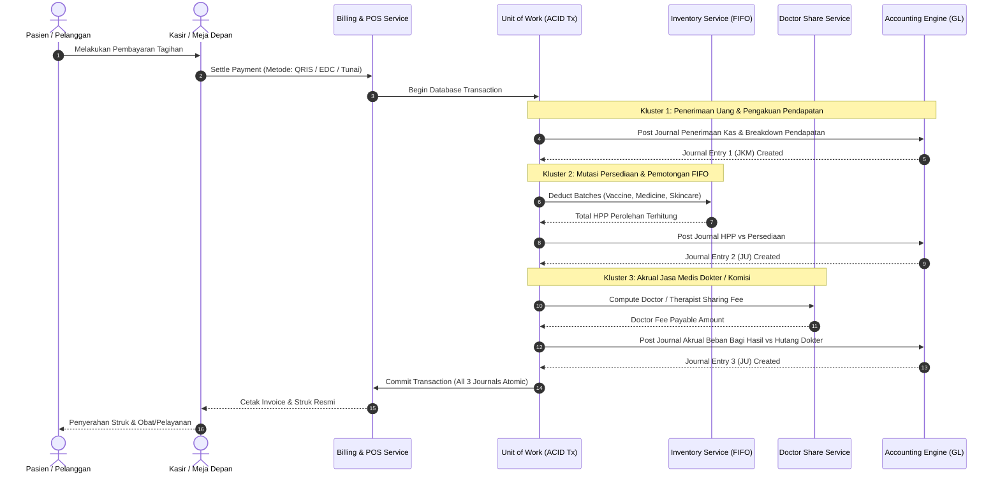
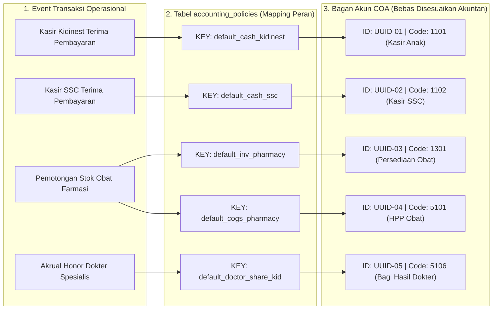
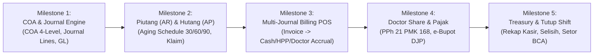

# BLUEPRINT ARSITEKTUR AKUNTANSI, PERPAJAKAN & ALUR TRANSAKSI
## Sistem ERP Akuntansi Terintegrasi Multi-Unit: Kidinest & Semarang Skin Center (SSC)
### Dokumen Spesifikasi Desain Domain-Driven Design (DDD), Alur Transaksi, & Perpajakan Medis

---

> [!IMPORTANT]
> **Tujuan Dokumen:**
> Dokumen ini adalah panduan arsitektur dan cetak biru teknis (*technical blueprint*) untuk mengimplementasikan sistem akuntansi, pembukuan berpasangan (*double-entry bookkeeping*), manajemen persediaan medis FIFO, perhitungan bagi hasil dokter (*doctor sharing fee*), rekonsiliasi kasir (*end-of-shift*), serta pelaporan perpajakan resmi (*clinic_pajak*) untuk dua unit bisnis dalam satu payung:
> 1. **Kidinest**: Klinik Spesialis Anak, Tumbuh Kembang, Vaksinasi & Farmasi Pediatrik.
> 2. **Semarang Skin Center (SSC)**: Klinik Estetika Medis, Dermatologi, Treatment Facial/Laser, & Produk Skincare.

---

## 1. Komparasi Paradigma: ERP Konstruksi (Brayo) vs. ERP Klinik Medis & Estetika

| Dimensi | Brayo (Developer & Konstruksi) | Klinik (Kidinest & Semarang Skin Center) |
| :--- | :--- | :--- |
| **Pusat Biaya / Dimensi (*Cost Center*)** | Berbasis Proyek Fisik (`PROJ-0008`, `PROJ-0009 Klero`) | Berbasis Unit Layanan (`UNIT-KIDINEST`, `UNIT-SSC`, `SHARED-BACKOFFICE`) |
| **Karakteristik & Frekuensi Transaksi** | Volume rendah, nominal besar (*milestone*, termin, retensi) | Volume sangat tinggi (*high-frequency*), nominal mikro-menengah, *real-time* POS |
| **Pengakuan Pendapatan (*Revenue Recognition*)** | Berdasarkan persentase penyelesaian fisik (*POC*) | Titik penjualan instan (*Point of Sale / Single Patient Billing*) |
| **Manajemen Persediaan (*Inventory*)** | Bahan bangunan (semen, pasir, besi) & unit rumah | Obat, Vaksin, BMHP, Krim Skincare wajib berbasis **Batch Number & Expired Date (FIFO)** |
| **Pajak Utama (*Taxation*)** | PPh Final Jasa Konstruksi (PP 9/2022 Ps. 4(2) 2502) | **PPh 21 Dokter Tenaga Ahli** (DPP 50% Progresif PMK 168/2023), **PPN Skincare/Estetika**, PPh 21 Karyawan |
| **Bagi Hasil Jasa Medis** | Subkontraktor & Mandor | **Doctor Sharing Fee** (misal 70:30 atau 60:40) dipotong PPh 21 resmi saat pencairan honor |
| **Alur Kasir (*Cashier Workflow*)** | Surat Tagihan / Invoice Termin Proyek | Registrasi di awal (Kidinest) vs. Reservasi bayar di akhir (SSC), Tutup Shift Kasir Harian |

---

## 2. Struktur Bagan Akun Standar / Chart of Accounts (COA) 4-Level

Struktur akun dirancang 4 level dengan pemisahan tegas pos pendapatan, persediaan, HPP, beban operasional, dan kewajiban perpajakan:

```mermaid
graph TD
    Root["COA Multi-Unit Klinik"]
    Root --> A1["1-0000 AKTIVA / ASSETS (DEBIT)"]
    Root --> A2["2-0000 KEWAJIBAN / LIABILITIES (CREDIT)"]
    Root --> A3["3-0000 MODAL / EQUITY (CREDIT)"]
    Root --> A4["4-0000 PENDAPATAN / REVENUE (CREDIT)"]
    Root --> A5["5-0000 HPP / COGS (DEBIT)"]
    Root --> A6["6-0000 BEBAN OPERASIONAL (DEBIT)"]

    A1 --> A1_Kas["1-1100 Kas & Bank (Kasir Kidinest, Kasir SSC, BCA, Mandiri, Transit)"]
    A1 --> A1_AR["1-1200 Piutang Pasien & Klaim Asuransi"]
    A1 --> A1_Inv["1-1300 Persediaan Obat, Vaksin, Skincare, & BMHP (FIFO)"]
    A1 --> A1_FA["1-2000 Aset Tetap & Akumulasi Penyusutan"]

    A2 --> A2_AP["2-1100 Hutang Supplier PBF Farmasi & Skincare"]
    A2 --> A2_Doc["2-1200 Hutang Jasa Medis Dokter & Komisi Terapis"]
    A2 --> A2_Tax["2-1500 Hutang Pajak (PPh 21 Dokter, PPh 23, PPh 4(2), PPN)"]

    A4 --> A4_Kid["4-1000 Pendapatan Unit Kidinest (Poli Anak, Vaksin, Tumbuh Kembang, Obat)"]
    A4 --> A4_SSC["4-2000 Pendapatan Unit SSC (Konsul Kulit, Facial, Laser, Skincare)"]
    A4 --> A4_Disc["4-9000 Potongan Diskon Promosi & Selisih Kas Lebih"]

    A5 --> A5_Kid["5-1000 HPP & Sharing Dokter Kidinest"]
    A5 --> A5_SSC["5-2000 HPP & Sharing Dokter/Terapis SSC"]
```



### Tabel Rinci Akun COA:

| Kode Akun | Nama Akun | Tipe | Saldo Normal | Keterangan & Bounded Context |
| :--- | :--- | :--- | :--- | :--- |
| **1-0000** | **AKTIVA / ASSETS** | ASSET | DEBIT | Header Klasifikasi Utama |
| 1-1000 | Aset Lancar | ASSET | DEBIT | Header Subklasifikasi |
| 1-1100 | Kas & Setara Kas | ASSET | DEBIT | Header Kas & Bank |
| **1-1111** | Kas Kasir Kidinest | ASSET | DEBIT | Kas fisik di laci kasir Unit Kidinest (Poli Anak) |
| **1-1112** | Kas Kasir Semarang Skin Center (SSC) | ASSET | DEBIT | Kas fisik di laci kasir Unit SSC (Estetika) |
| 1-1113 | Kas Kecil Operasional (Petty Cash) | ASSET | DEBIT | Kas kecil pengeluaran operasional harian kantor |
| 1-1121 | Bank BCA Operasional | ASSET | DEBIT | Rekening giro/tabungan operasional utama BCA |
| 1-1122 | Bank Mandiri Operasional | ASSET | DEBIT | Rekening operasional cadangan Bank Mandiri |
| **1-1130** | Kliring Payment Gateway (QRIS/Settlement) | ASSET | DEBIT | Akun transit penerimaan QRIS / Virtual Account belum cair |
| **1-1131** | Piutang EDC Mesin Belum Settlement | ASSET | DEBIT | Akun transit gesek EDC (batching malam hari) |
| 1-1200 | Piutang Usaha & Klaim | ASSET | DEBIT | Header Piutang |
| 1-1210 | Piutang Pasien Perawatan | ASSET | DEBIT | Tagihan pasien yang belum lunas |
| 1-1220 | Piutang Klaim Asuransi Mandiri / Korporat | ASSET | DEBIT | Piutang tagihan klaim asuransi & korporat |
| 1-1300 | Persediaan Medis & Farmasi (Inventory) | ASSET | DEBIT | Header Persediaan Berbasis Batch FIFO |
| **1-1310** | Persediaan Obat Paten & Sirup Anak | ASSET | DEBIT | Stok fisik obat anak (Kidinest) |
| **1-1311** | Persediaan Vaksin & Imunisasi Anak | ASSET | DEBIT | Stok ampul vaksin wajib & tambahan anak (Kidinest) |
| 1-1312 | Persediaan Bahan Baku Obat Racikan Anak | ASSET | DEBIT | Serbuk, sirup pembawa, dan cangkang kapsul anak |
| 1-1320 | Persediaan Bahan Medis Habis Pakai (BMHP) | ASSET | DEBIT | Spuit, jarum suntik, kassa, alkohol swab, plester |
| **1-1330** | Persediaan Produk Skincare & Kosmetika SSC | ASSET | DEBIT | Krim racikan, serum wajah, toner, sunscreen (SSC) |
| **1-1331** | Persediaan Bahan Tindakan Treatment Facial | ASSET | DEBIT | Bahan peeling, serum facial, masker treatment (SSC) |
| 1-2000 | Aset Tetap | ASSET | DEBIT | Header Aktiva Tetap |
| 1-2100 | Peralatan Medis Poli Anak | ASSET | DEBIT | Timbangan bayi digital, stetoskop anak, USG anak |
| 1-2200 | Peralatan Estetika SSC | ASSET | DEBIT | Mesin laser Nd:YAG, cauter, alat microdermabrasi |
| 1-2300 | Renovasi Bangunan Klinik & Interior | ASSET | DEBIT | Biaya renovasi & interior klinik yang dikapitalisasi |
| 1-2900 | Akumulasi Penyusutan Aset Tetap | ASSET | CREDIT | Akun kontra aktiva tetap |
| **2-0000** | **KEWAJIBAN / LIABILITIES** | LIABILITY | CREDIT | Header Kewajiban |
| 2-1000 | Kewajiban Jangka Pendek | LIABILITY | CREDIT | Header Hutang Lancar |
| 2-1110 | Hutang Supplier Farmasi & PBF | LIABILITY | CREDIT | Hutang pembelian obat & vaksin ke distributor PBF |
| 2-1120 | Hutang Supplier Produk Skincare & Estetika | LIABILITY | CREDIT | Hutang pembelian bahan krim & kosmetika SSC |
| **2-1210** | Hutang Jasa Medis Dokter Kidinest | LIABILITY | CREDIT | Akrual bagi hasil dokter spesialis anak belum dibayar |
| **2-1220** | Hutang Jasa Medis Dokter SSC | LIABILITY | CREDIT | Akrual bagi hasil dokter spesialis kulit belum dibayar |
| **2-1230** | Hutang Komisi / Fee Terapis & Beautician SSC | LIABILITY | CREDIT | Akrual komisi pengerjaan facial terapis SSC |
| 2-1310 | Hutang Gaji Karyawan & Tenaga Medis | LIABILITY | CREDIT | Akrual gaji perawat, apoteker, kasir, staf klinik |
| 2-1410 | Uang Muka / Titipan Deposit Pasien | LIABILITY | CREDIT | Deposit uang muka reservasi / paket tindakan pasien |
| **2-1500** | Hutang Perpajakan Klinik (Tax Liabilities) | LIABILITY | CREDIT | Header Perpajakan Resmi (*clinic_pajak*) |
| **2-1501.01** | Hutang PPh 21 Karyawan (TER PP 58/2023) | LIABILITY | CREDIT | Potongan pajak penghasilan pegawai tetap klinik |
| **2-1501.02** | Hutang PPh 21 Dokter Tenaga Medis Ahli | LIABILITY | CREDIT | Potongan PPh 21 Bukan Pegawai (DPP 50% Progresif) |
| 2-1502 | Hutang PPh 23 (Limbah B3 & Servis Alat) | LIABILITY | CREDIT | Pemotongan 2% atas vendor limbah B3 / servis IT |
| 2-1503 | Hutang PPh Final Pasal 4(2) (Sewa Gedung) | LIABILITY | CREDIT | Pemotongan 10% atas sewa gedung ruko klinik |
| **2-1504** | Hutang PPN Keluaran | LIABILITY | CREDIT | PPN 11%/12% atas penjualan skincare & treatment non-medis |
| 2-1505 | PPN Masukan | LIABILITY | DEBIT | Kredit pajak faktur pembelian obat/bahan jika PKP |
| **3-0000** | **MODAL / EQUITY** | EQUITY | CREDIT | Header Ekuitas |
| 3-1100 | Modal Disetor Pemilik Klinik | EQUITY | CREDIT | Modal awal pendirian klinik |
| 3-1200 | Laba Ditahan (Retained Earnings) | EQUITY | CREDIT | Akumulasi laba bersih periode tahun-tahun sebelumnya |
| 3-1300 | Laba Bersih Periode Berjalan | EQUITY | CREDIT | Laba bersih tahun berjalan hasil penutupan buku |
| **4-0000** | **PENDAPATAN / REVENUE** | REVENUE | CREDIT | Header Pendapatan |
| **4-1000** | **PENDAPATAN UNIT KIDINEST (ANAK)** | REVENUE | CREDIT | Header Sub-Unit Kidinest |
| 4-1110 | Pendapatan Registrasi & Skrining Anak | REVENUE | CREDIT | Biaya kartu, administrasi pendaftaran pasien anak |
| 4-1120 | Pendapatan Jasa Konsultasi Spesialis Anak | REVENUE | CREDIT | Biaya jasa konsultasi dokter spesialis anak (Sp.A) |
| 4-1130 | Pendapatan Jasa Tindakan Vaksinasi & Imunisasi | REVENUE | CREDIT | Biaya jasa medis penyuntikan vaksin anak |
| 4-1140 | Pendapatan Layanan Terapi & Tumbuh Kembang | REVENUE | CREDIT | Paket Denver II, skrining tumbuh kembang, stimulasi |
| 4-1150 | Pendapatan Penjualan Obat Resep Farmasi Anak | REVENUE | CREDIT | Penjualan obat paten dan sirup racikan farmasi anak |
| **4-2000** | **PENDAPATAN UNIT SEMARANG SKIN CENTER** | REVENUE | CREDIT | Header Sub-Unit SSC |
| 4-2110 | Pendapatan Konsultasi Dokter Estetika / Kulit | REVENUE | CREDIT | Jasa konsultasi dokter spesialis kulit & kelamin (Sp.DVE) |
| 4-2120 | Pendapatan Tindakan Medis Estetika | REVENUE | CREDIT | Tindakan medis dokter: Laser, Cauter, Chemical Peeling |
| 4-2130 | Pendapatan Tindakan Facial & Treatment Terapis | REVENUE | CREDIT | Tindakan estetika oleh beautician/terapis |
| 4-2140 | Pendapatan Penjualan Produk Skincare & Kosmetika | REVENUE | CREDIT | Penjualan krim malam, krim pagi, serum, sunscreen |
| **4-9000** | **POTONGAN & PENYESUAIAN PENDAPATAN** | REVENUE | DEBIT/CREDIT | Akun Koreksi & Penyesuaian Kasir |
| 4-9100 | Potongan Diskon Promosi & Voucher Pasien | REVENUE | DEBIT | Diskon kupon / potongan promosi tagihan kasir |
| 4-9200 | Pendapatan Selisih Kas Lebih (Cash Overage) | REVENUE | CREDIT | Selisih lebih uang fisik kasir saat tutup shift |
| **5-0000** | **HARGA POKOK PENJUALAN / HPP** | COGS | DEBIT | Header Beban Pokok Pendapatan |
| **5-1000** | **HPP MEDIS & FARMASI KIDINEST** | COGS | DEBIT | Header HPP Unit Kidinest |
| 5-1110 | HPP Obat Resep Anak | COGS | DEBIT | Nilai pokok perolehan (FIFO) obat farmasi anak |
| 5-1120 | HPP Vaksin & Serum Anak | COGS | DEBIT | Nilai pokok perolehan (FIFO) vaksin anak |
| 5-1130 | HPP Bahan Medis Habis Pakai Poli Anak | COGS | DEBIT | Nilai pokok spuit, jarum suntik, dan kassa terpakai |
| **5-1210** | Beban Bagi Hasil Dokter Spesialis Anak | COGS | DEBIT | Biaya jasa medis dokter anak (misal 70% dari jasa medis) |
| **5-2000** | **HPP ESTETIKA SEMARANG SKIN CENTER** | COGS | DEBIT | Header HPP Unit SSC |
| 5-2110 | HPP Produk Skincare & Krim Terjual | COGS | DEBIT | Nilai pokok perolehan (FIFO) krim & kosmetika SSC |
| 5-2120 | HPP Bahan Tindakan Treatment Facial | COGS | DEBIT | Nilai pokok bahan facial & cairan peeling terpakai |
| **5-2210** | Beban Bagi Hasil Dokter Estetika SSC | COGS | DEBIT | Biaya jasa medis dokter spesialis kulit SSC |
| **5-2220** | Beban Komisi Tindakan Terapis SSC | COGS | DEBIT | Komisi pengerjaan per tindakan untuk beautician |
| **6-0000** | **BEBAN OPERASIONAL & UMUM** | EXPENSE | DEBIT | Header Biaya Operasional Rutin |
| 6-1100 | Beban Gaji & Tunjangan Karyawan | EXPENSE | DEBIT | Gaji perawat, apoteker, kasir, front office |
| 6-1200 | Beban Pengolahan & Pemusnahan Limbah Medis B3 | EXPENSE | DEBIT | Biaya vendor resmi transporter & incinerator limbah B3 |
| 6-1300 | Beban Kalibrasi & Pemeliharaan Alat Medis | EXPENSE | DEBIT | Kalibrasi tahunan alat medis dan uji kelayakan Dinkes |
| 6-1400 | Beban Kemasan Farmasi | EXPENSE | DEBIT | Plastik klip obat, etiket resep, paperbag klinik |
| 6-1500 | Beban Utilitas Klinik | EXPENSE | DEBIT | Tagihan listrik PLN ruko praktek, PDAM, internet WiFi |
| 6-1600 | Beban Pemasaran & Media Sosial Klinik | EXPENSE | DEBIT | Biaya iklan Instagram/TikTok dan promosi klinik |
| 6-1700 | Beban Selisih Kas Kasir (Cash Shortage) | EXPENSE | DEBIT | Selisih kurang uang fisik kasir saat tutup shift |

---

## 3. Matriks Regulasi Perpajakan Klinik Medis & Estetika (*clinic_pajak*)

### A. PPh Pasal 21 Dokter Tenaga Ahli (Bukan Pegawai Berkesinambungan)
Berdasarkan **PMK No. 168/2023** dan **UU HPP No. 7/2021**:
* Dokter praktek di klinik (Sp.A dan Sp.DVE) berstatus **Bukan Pegawai yang Menerima Penghasilan Berkesinambungan**.
* **Dasar Pengenaan Pajak (DPP):**
  $$\text{DPP} = 50\% \times \text{Penghasilan Bruto Jasa Medis}$$
* **Tarif:** Dikenakan tarif progresif Pasal 17 ayat (1) huruf a UU HPP atas kumulatif DPP tahun berjalan:
  * Rp 0 s/d Rp 60.000.000: **5%**
  * Rp 60.000.000 s/d Rp 250.000.000: **15%**
  * Rp 250.000.000 s/d Rp 500.000.000: **25%**
  * Rp 500.000.000 s/d Rp 5.000.000.000: **30%**
  * Di atas Rp 5.000.000.000: **35%**

#### Contoh Kasus Nyata Perhitungan & Pemotongan:
Dokter Spesialis Anak memiliki akumulasi jasa medis kotor bulan ini sebesar Rp 20.000.000:
$$\text{DPP} = 50\% \times \text{Rp } 20.000.000 = \text{Rp } 10.000.000$$
$$\text{PPh 21 Terutang} = 5\% \times \text{Rp } 10.000.000 = \text{Rp } 500.000$$
$$\text{Transfer Bersih (Take Home Pay)} = \text{Rp } 20.000.000 - \text{Rp } 500.000 = \text{Rp } 19.500.000$$

Sistem otomatis menerbitkan baris data untuk **e-Bupot 21/26 DJP** dengan kode objek pajak `21-100-07` (Tenaga Ahli).

### B. Pajak Pertambahan Nilai (PPN)
* **Kidinest (Pelayanan Medis Anak):**
  Bebas PPN sesuai Pasal 4A ayat (3) UU PPN jo. UU HPP (Jasa Pelayanan Kesehatan Medis tidak dikenai PPN). Obat resep dokter anak rawat jalan melekat pada jasa medis sehingga tidak terutang PPN.
* **Semarang Skin Center (SSC):**
  * *Tindakan Medis Kulit oleh Dokter (pengobatan jerawat radang, infeksi kulit, dermatitis):* Bebas PPN (Jasa Medis).
  * *Tindakan Estetika Non-Medis (Facial relaksasi murni):* Kena PPN jika klinik sudah PKP.
  * *Penjualan Produk Skincare & Sunscreen OTC:* Merupakan Barang Kena Pajak (BKP). Jika status klinik sudah PKP (omzet > Rp 4,8 Milyar/tahun), sistem memungut PPN 11% (atau 12%) ke akun `2-1504`. Jika masih Non-PKP, fitur PPN berada pada mode non-aktif (*configurable flag*).

### C. PPh Pasal 23 & PPh Pasal 4 ayat (2)
* **PPh Pasal 23 (Tarif 2%):** Wajib dipotong klinik saat membayar jasa vendor pengolahan limbah B3 medis atau kalibrasi alat medis.
* **PPh Pasal 4 ayat (2) (Tarif 10% Final):** Wajib dipotong atas pembayaran sewa gedung ruko klinik.

---

## 4. Alur Transaksi Operasional & Multi-Jurnal Otomatis Terhubung

Setiap 1 transaksi pembayaran di meja kasir secara atomik memicu **3 kluster jurnal** yang saling terhubung:



### Simulasi Kasus Nyata

#### Kasus A: Pasien Anak Kidinest (Vaksinasi + Konsultasi + Obat)
* Total Tagihan Pasien: **Rp 750.000** (Registrasi: Rp 50.000, Jasa Dokter: Rp 300.000, Vaksin: Rp 300.000, Obat: Rp 100.000).
* Bagi Hasil Dokter Spesialis Anak: **70%** dari Jasa Medis = Rp 210.000.
* HPP Batch Vaksin: Rp 180.000. HPP Obat: Rp 60.000.
* Pembayaran: **QRIS Dinamis** (Kliring Transit `1-1130`).

```
[JURNAL 1: PEMBAYARAN KASIR / BILLING]
(DEBIT)  1-1130 Kliring Payment Gateway QRIS             Rp 750.000
(KREDIT) 4-1110 Pendapatan Registrasi & Skrining Anak    Rp  50.000
(KREDIT) 4-1120 Pendapatan Jasa Dokter Spesialis Anak    Rp 300.000
(KREDIT) 4-1130 Pendapatan Tindakan Vaksinasi            Rp 300.000
(KREDIT) 4-1150 Pendapatan Penjualan Obat Farmasi        Rp 100.000

[JURNAL 2: MUTASI PERSEDIAAN & HPP FIFO]
(DEBIT)  5-1120 HPP Vaksin & Serum Anak                 Rp 180.000
(DEBIT)  5-1110 HPP Obat Resep Anak                     Rp  60.000
(KREDIT) 1-1311 Persediaan Vaksin & Imunisasi Anak       Rp 180.000
(KREDIT) 1-1310 Persediaan Obat Paten & Sirup Anak       Rp  60.000

[JURNAL 3: AKRUAL HUKUM JASA MEDIS DOKTER]
(DEBIT)  5-1210 Beban Bagi Hasil Dokter Spesialis Anak   Rp 210.000
(KREDIT) 2-1210 Hutang Jasa Medis Dokter Kidinest        Rp 210.000
```

#### Kasus B: Pasien Semarang Skin Center (SSC) (Facial + Krim Skincare)
* Total Tagihan: **Rp 550.000** (Konsultasi & Tindakan: Rp 350.000, Produk Skincare: Rp 200.000).
* Bagi Hasil Dokter & Komisi Terapis: Dokter Rp 100.000, Terapis Rp 40.000.
* HPP Krim Skincare: Rp 90.000. HPP Bahan Facial: Rp 30.000.
* Pembayaran: **Mesin EDC BCA** (Piutang Transit `1-1131`).

```
[JURNAL 1: PEMBAYARAN KASIR SSC]
(DEBIT)  1-1131 Piutang EDC Mesin Belum Settlement       Rp 550.000
(KREDIT) 4-2110 Pendapatan Konsultasi Dokter SSC         Rp 100.000
(KREDIT) 4-2130 Pendapatan Tindakan Facial SSC           Rp 250.000
(KREDIT) 4-2140 Pendapatan Penjualan Produk Skincare     Rp 200.000

[JURNAL 2: HPP & PEMAKAIAN BAHAN ESTETIKA]
(DEBIT)  5-2110 HPP Produk Skincare Terjual              Rp  90.000
(DEBIT)  5-2120 HPP Bahan Tindakan Treatment Facial      Rp  30.000
(KREDIT) 1-1330 Persediaan Produk Skincare & Kosmetika   Rp  90.000
(KREDIT) 1-1331 Persediaan Bahan Treatment Facial        Rp  30.000

[JURNAL 3: AKRUAL FEE DOKTER & TERAPIS]
(DEBIT)  5-2210 Beban Bagi Hasil Dokter Estetika SSC     Rp 100.000
(DEBIT)  5-2220 Beban Komisi Tindakan Terapis SSC        Rp  40.000
(KREDIT) 2-1220 Hutang Jasa Medis Dokter SSC             Rp 100.000
(KREDIT) 2-1230 Hutang Komisi Terapis & Beautician SSC   Rp  40.000
```

#### Kasus C: Pembayaran Honor Dokter Akhir Bulan & Pemotongan PPh 21
Dokter Spesialis Anak memiliki akumulasi jasa medis kotor bulan ini sebesar Rp 20.000.000.
PPh 21 dipotong = $5\% \times (50\% \times \text{Rp } 20.000.000) = \text{Rp } 500.000$.
Dibayarkan melalui transfer dari Bank BCA:

```
[JURNAL PENGGAJIAN / HONOR DOKTER]
(DEBIT)  2-1210 Hutang Jasa Medis Dokter Kidinest        Rp 20.000.000
(KREDIT) 2-1501.02 Hutang PPh 21 Dokter Tenaga Ahli      Rp    500.000
(KREDIT) 1-1121 Bank BCA Operasional                     Rp 19.500.000

[SAAT KLINIK MENYETOR PPH 21 KE KAS NEGARA VIA E-BILLING]
(DEBIT)  2-1501.02 Hutang PPh 21 Dokter Tenaga Ahli      Rp    500.000
(KREDIT) 1-1121 Bank BCA Operasional                     Rp    500.000
```

#### Kasus D: Tutup Shift Kasir Harian & Setoran Bank BCA
1. Kasir Kidinest mengakhiri shift. Penerimaan tunai sistem tercatat Rp 3.000.000.
2. Kasir menghitung fisik uang:
   * **Skenario A (Fisik Rp 2.980.000 / Kurang Rp 20.000):**
     ```
     (DEBIT)  6-1700 Beban Selisih Kas Kasir (Shortage)      Rp 20.000
     (KREDIT) 1-1111 Kas Kasir Kidinest                      Rp 20.000
     ```
   * **Skenario B (Fisik Rp 3.050.000 / Lebih Rp 50.000):**
     ```
     (DEBIT)  1-1111 Kas Kasir Kidinest                      Rp 50.000
     (KREDIT) 4-9200 Pendapatan Selisih Kas Lebih (Overage)  Rp 50.000
     ```
3. Setoran Fisik Kasir ke Rekening Bank BCA:
   ```
   (DEBIT)  1-1121 Bank BCA Operasional                    Rp 3.000.000
   (KREDIT) 1-1111 Kas Kasir Kidinest                      Rp 3.000.000
   ```

---

## 5. Standar Bagan Akun Dinamis 4-Digit & Struktur Laporan Neraca / Laba Rugi

> [!NOTE]
> **Filosofi Desain Dinamis ala ERPNext:**
> Bagan Akun (*Chart of Accounts / COA*) di bawah ini mengadopsi standar hierarki penomoran 4-digit industri (PSAK / Akuntansi Standar Indonesia) yang fleksibel. Nama akun dan nomor kode dapat disesuaikan oleh manajemen atau akuntan di database tanpa merusak logika aplikasi Go backend, karena sistem menggunakan **Pola Pemetaan Peran (*Default Account Role Mapping*)**.

### A. Format Struktur Laporan Neraca (Balance Sheet)
*Mencakup Kelompok Akun 1 (Aset), Kelompok 2 (Kewajiban), dan Kelompok 3 (Ekuitas) sesuai tampilan standar sistem laporan akuntansi:*

| Kode Akun | Nama Akun COA | Tipe Akun | Saldo Normal | Sub-Unit & Keterangan Operasional |
| :--- | :--- | :---: | :---: | :--- |
| **1 - ASET** | **AKTIVA / ASSET** | **ASSET** | **DEBIT** | **Klasifikasi Utama Aset** |
| **11** | **KAS DAN BANK** | **ASSET** | **DEBIT** | **Header Kas & Setara Kas** |
| 1101 | Kas Kasir Kidinest (Poli Anak) | ASSET | DEBIT | Kas fisik di meja kasir Unit Kidinest |
| 1102 | Kas Kasir Semarang Skin Center (SSC) | ASSET | DEBIT | Kas fisik di meja kasir Unit SSC |
| 1103 | Kas Kecil / Petty Cash Operasional | ASSET | DEBIT | Kas pengeluaran operasional harian kantor |
| 1104 | Bank BCA Operasional | ASSET | DEBIT | Rekening giro/tabungan utama operasional BCA |
| 1105 | Bank Mandiri Operasional | ASSET | DEBIT | Rekening cadangan / payroll Bank Mandiri |
| 1106 | Settlement QRIS & EDC Transit | ASSET | DEBIT | Kliring sementara pembayaran digital sebelum masuk bank |
| **12** | **PIUTANG** | **ASSET** | **DEBIT** | **Header Piutang Usaha** |
| 1201 | Piutang Pasien Perawatan | ASSET | DEBIT | Piutang tindakan pasien rawat jalan/estetika |
| 1202 | Piutang Klaim Asuransi / BPJS / Korporat | ASSET | DEBIT | Tagihan klaim jaminan ke asuransi rekanan |
| 1203 | Cadangan Kerugian Piutang | ASSET | CREDIT | Kontra-aset estimasi piutang macet/kadaluarsa |
| **13** | **PERSEDIAAN** | **ASSET** | **DEBIT** | **Header Persediaan Medis & Non-Medis (FIFO)** |
| 1301 | Persediaan Obat & Sirup Anak (Kidinest) | ASSET | DEBIT | Stok obat paten, sirup, racikan farmasi anak |
| 1302 | Persediaan Produk Skincare & Kosmetika (SSC) | ASSET | DEBIT | Stok krim malam, krim pagi, serum, sunscreen SSC |
| 1303 | Persediaan Bahan Medis Habis Pakai (BMHP) | ASSET | DEBIT | Stok spuit, jarum suntik, kassa, infus, alkohol |
| 1304 | Persediaan Vaksin & Serum Anak (Kidinest) | ASSET | DEBIT | Stok vaksin dasar & lanjutan cold chain Kidinest |
| **14** | **INVESTASI** | **ASSET** | **DEBIT** | **Header Investasi Jangka Panjang** |
| 1401 | Investasi Tanah & Gedung Cabang | ASSET | DEBIT | Kepemilikan aset tanah/bangunan perluasan klinik |
| 1402 | Investasi Pengembangan Formula Skincare SSC | ASSET | DEBIT | Aset tidak berwujud / HKI formulasi produk SSC |
| **15** | **BIAYA DIBAYAR DI MUKA** | **ASSET** | **DEBIT** | **Header Beban Ditangguhkan (Prepaid Expense)** |
| 1501 | Sewa Gedung & Ruko Dibayar di Muka | ASSET | DEBIT | Alokasi per bulan amortisasi sewa tempat praktek |
| 1502 | Uang Muka Pembelian Alat Medis (DP) | ASSET | DEBIT | Uang muka pemesanan laser/alat medis baru |
| 1503 | Asuransi Kebakaran & Malpraktik Dibayar di Muka | ASSET | DEBIT | Premi tahunan asuransi klinik dibayar di muka |
| **16** | **AKTIVA TETAP** | **ASSET** | **DEBIT** | **Header Aset Tetap Berwujud** |
| 1601 | Bangunan & Renovasi Interior Klinik | ASSET | DEBIT | Biaya fit-out ruko, poli anak, & ruang treatment |
| 1602 | Mesin & Alat Medis Estetika (Laser/Facial SSC) | ASSET | DEBIT | Mesin Laser Q-Switched, Cauter, IPL, HydraFacial |
| 1603 | Peralatan Medis Poli Anak & Vaccine Chiller | ASSET | DEBIT | Kulkas medis cold chain, nebulizer, timbangan anak |
| 1604 | Inventaris Kantor, Komputer & Perangkat POS | ASSET | DEBIT | Laptop, thermal printer kasir, AC, furniture ruko |
| 1605 | Kendaraan Operasional Klinik | ASSET | DEBIT | Mobil operasional jemputan dokter & logistik farmasi |
| 1606 | Akumulasi Penyusutan Aktiva Tetap | ASSET | CREDIT | Akumulasi depresiasi metode garis lurus (*Contra-Asset*) |
| **2 - KEWAJIBAN** | **KEWAJIBAN / LIABILITAS** | **LIABILITY** | **CREDIT** | **Klasifikasi Utama Kewajiban** |
| **21** | **UANG MUKA & TITIPAN** | **LIABILITY** | **CREDIT** | **Header Pendapatan Ditangguhkan** |
| 2101 | Uang Muka / Deposit Pasien Paket Treatment SSC | LIABILITY | CREDIT | Pembayaran di awal untuk paket 5x/10x facial laser |
| 2102 | Titipan Booking Pasien & Pendaftaran | LIABILITY | CREDIT | Down payment reservasi jadwal dokter spesialis |
| **22** | **HUTANG DAGANG & SUPPLIER** | **LIABILITY** | **CREDIT** | **Header Hutang Usaha Pengadaan** |
| 2201 | Hutang Distributor Farmasi (PBF) | LIABILITY | CREDIT | Tagihan jatuh tempo faktur obat dari distributor PBF |
| 2202 | Hutang Supplier & Pabrik Maklon Skincare SSC | LIABILITY | CREDIT | Tagihan produksi krim dan kosmetika ber-BPOM |
| 2203 | Hutang Vendor Bahan Medis Habis Pakai (BMHP) | LIABILITY | CREDIT | Tagihan jarum, spuit, kassa steril, antiseptic |
| **23** | **HUTANG BANK** | **LIABILITY** | **CREDIT** | **Header Pinjaman Bank & Lembaga Finansial** |
| 2301 | Hutang Kredit Modal Kerja (KMK) Operasional | LIABILITY | CREDIT | Fasilitas pinjaman modal kerja bergulir dari perbankan |
| 2302 | Hutang Kredit Investasi Alat Medis | LIABILITY | CREDIT | Fasilitas cicilan leasing alat laser/medis klinik |
| **24** | **HUTANG PIHAK KETIGA & JASA MEDIS** | **LIABILITY** | **CREDIT** | **Header Kewajiban Medis & Pemegang Saham** |
| 2401 | Hutang Bagi Hasil Jasa Dokter Spesialis Anak | LIABILITY | CREDIT | Saldo honor dokter anak sebelum dipotong PPh 21 |
| 2402 | Hutang Bagi Hasil Dokter Kulit & Estetika SSC | LIABILITY | CREDIT | Saldo honor dokter Sp.DVE sebelum dipotong PPh 21 |
| 2403 | Hutang Komisi Tindakan Terapis / Beautician | LIABILITY | CREDIT | Saldo komisi bulanan staf beautician SSC |
| 2404 | Hutang Pemegang Saham / Pihak Terelasi | LIABILITY | CREDIT | Pinjaman dana talangan dari pendiri/owner |
| **25** | **HUTANG PAJAK** | **LIABILITY** | **CREDIT** | **Header Pajak Terutang (Clinic Pajak)** |
| 2501 | Hutang PPh 21 Dokter Tenaga Ahli (PMK 168/2023) | LIABILITY | CREDIT | Potongan PPh 21 honor dokter (objek e-Bupot 21-100-07) |
| 2502 | Hutang PPh 21 Karyawan & Perawat | LIABILITY | CREDIT | Potongan PPh 21 pegawai tetap bulanan |
| 2503 | Hutang PPh 23 Vendor Limbah B3 & Kalibrasi | LIABILITY | CREDIT | Potongan 2% jasa teknik & pengolahan limbah medis |
| 2504 | Hutang PPh Final 4 ayat (2) Sewa Gedung | LIABILITY | CREDIT | Potongan 10% atas pembayaran sewa ruko klinik |
| 2505 | Hutang PPN Keluaran (Jika Klinik PKP) | LIABILITY | CREDIT | PPN 11%/12% penjualan produk kosmetika/skincare OTC |
| **26** | **HUTANG PEMBEBANAN AKRUAL** | **LIABILITY** | **CREDIT** | **Header Beban Akrual Akhir Bulan** |
| 2601 | Hutang Akrual Gaji & THR Karyawan | LIABILITY | CREDIT | Beban gaji bulan berjalan yang belum ditransfer |
| 2602 | Hutang Akrual Listrik PLN, Air & Internet | LIABILITY | CREDIT | Beban utilitas bulan berjalan yang belum terbayar |
| **3 - EKUITAS** | **EKUITAS & MODAL** | **EQUITY** | **CREDIT** | **Klasifikasi Utama Permodalan** |
| **31** | **MODAL** | **EQUITY** | **CREDIT** | **Header Modal Pemilik** |
| 3101 | Setoran Modal Awal Pendiri / Pemegang Saham | EQUITY | CREDIT | Modal disetor klinik Kidinest & SSC |
| 3102 | Dividen / Prive Dibagi Pemilik | EQUITY | DEBIT | Pengambilan dividen pemilik (*Contra-Equity*) |
| **32** | **LABA AKUMULASI** | **EQUITY** | **CREDIT** | **Header Laba Ditahan** |
| 3201 | Laba Ditahan Tahun-Tahun Sebelumnya | EQUITY | CREDIT | Akumulasi laba bersih historis yang tidak dibagikan |
| 3202 | Laba / Rugi Periode Berjalan | EQUITY | CREDIT | Saldo laba/rugi bersih dari laporan laba rugi tahun berjalan |

---

### B. Format Struktur Laporan Laba Rugi (Income Statement)
*Mencakup Kelompok Akun 4 (Pendapatan), Kelompok 5 (HPP & Beban Medis Langsung), Kelompok 6 (Beban Operasional), dan Kelompok 7 (Non-Usaha):*

| Kode Akun | Nama Akun COA | Tipe Akun | Saldo Normal | Sub-Unit & Keterangan Operasional |
| :--- | :--- | :---: | :---: | :--- |
| **4 - PENDAPATAN** | **PENDAPATAN OPERASIONAL UTAMA** | **REVENUE** | **CREDIT** | **Klasifikasi Utama Pendapatan** |
| **41** | **PENDAPATAN LAYANAN & PRODUK** | **REVENUE** | **CREDIT** | **Header Pendapatan Usaha Medis & Estetika** |
| 4101 | Pendapatan Registrasi & Skrining Pasien Anak | REVENUE | CREDIT | Unit Kidinest: Biaya administrasi & pendaftaran pasien baru |
| 4102 | Pendapatan Jasa Konsultasi Spesialis Anak | REVENUE | CREDIT | Unit Kidinest: Jasa periksa dokter spesialis anak (Sp.A) |
| 4103 | Pendapatan Tindakan Vaksinasi & Imunisasi | REVENUE | CREDIT | Unit Kidinest: Tindakan suntik vaksinasi anak |
| 4104 | Pendapatan Penjualan Obat Farmasi Kidinest | REVENUE | CREDIT | Unit Kidinest: Penjualan obat paten dan sirup racikan |
| 4105 | Pendapatan Konsultasi Dokter Kulit & Estetika | REVENUE | CREDIT | Unit SSC: Jasa periksa dokter spesialis kulit (Sp.DVE) |
| 4106 | Pendapatan Tindakan Medis Dokter SSC | REVENUE | CREDIT | Unit SSC: Laser pigmen/vascular, cauter, chemical peeling |
| 4107 | Pendapatan Tindakan Facial & Treatment Terapis | REVENUE | CREDIT | Unit SSC: Facial komedo, microdermabrasi, IPL beautician |
| 4108 | Pendapatan Penjualan Produk Skincare & Kosmetika | REVENUE | CREDIT | Unit SSC: Penjualan krim racik, sunscreen, serum OTC |
| **49** | **POTONGAN & PENYESUAIAN PENDAPATAN** | **REVENUE** | **DEBIT/CREDIT** | **Header Akun Koreksi Kasir** |
| 4901 | Potongan Diskon Promosi & Voucher Pasien | REVENUE | DEBIT | Diskon promo, voucher member (*Contra-Revenue*) |
| 4902 | Pendapatan Selisih Kas Lebih (Cash Overage) | REVENUE | CREDIT | Selisih lebih uang fisik kasir saat rekonsiliasi shift |
| **5 - HPP** | **HARGA POKOK PENJUALAN & BEBAN MEDIS** | **COGS** | **DEBIT** | **Klasifikasi Utama Beban Pokok** |
| **51** | **HPP PRODUK & BIAYA MEDIS LANGSUNG** | **COGS** | **DEBIT** | **Header Beban Langsung Pelayanan** |
| 5101 | HPP Obat Resep & Paten Farmasi Kidinest | COGS | DEBIT | Nilai perolehan batch FIFO obat terjual (Kidinest) |
| 5102 | HPP Vaksin & Serum Imunisasi Kidinest | COGS | DEBIT | Nilai perolehan batch FIFO vaksin terpakai (Kidinest) |
| 5103 | HPP Produk Skincare & Kosmetika Terjual SSC | COGS | DEBIT | Nilai perolehan batch FIFO krim/skincare terjual (SSC) |
| 5104 | HPP Bahan Tindakan Facial & Peeling SSC | COGS | DEBIT | Nilai perolehan bahan serum/krim terpakai saat facial |
| 5105 | Beban Pemakaian Bahan Medis Habis Pakai (BMHP) | COGS | DEBIT | Spuit, kapas steril, kassa, handscoon terpakai |
| 5106 | Beban Bagi Hasil Dokter Spesialis Anak | COGS | DEBIT | Akrual honor porsi dokter anak (e.g. 70% dari jasa medis) |
| 5107 | Beban Bagi Hasil Dokter Estetika & Kulit SSC | COGS | DEBIT | Akrual honor porsi dokter kulit SSC |
| 5108 | Beban Komisi Tindakan Beautician / Terapis | COGS | DEBIT | Komisi pengerjaan per tindakan untuk beautician SSC |
| **6 - BEBAN** | **BEBAN OPERASIONAL & UMUM** | **EXPENSE** | **DEBIT** | **Klasifikasi Utama Beban Rutin** |
| **61** | **BEBAN UMUM & ADMINISTRASI** | **EXPENSE** | **DEBIT** | **Header Biaya Rutin Klinik** |
| 6101 | Beban Gaji Staf, Perawat, Apoteker & Kasir | EXPENSE | DEBIT | Gaji bulanan tim operasional pendukung non-dokter |
| 6102 | Beban Listrik PLN, Air PDAM & Internet Klinik | EXPENSE | DEBIT | Biaya utilitas bulanan operasional ruko klinik |
| 6103 | Beban Pengolahan Limbah Medis B3 | EXPENSE | DEBIT | Biaya vendor pengangkut & pemusnah jarum/limbah B3 |
| 6104 | Beban Kalibrasi & Pemeliharaan Alat Medis | EXPENSE | DEBIT | Uji berkala kelayakan alat medis & service mesin laser |
| 6105 | Beban Kemasan Obat & Perlengkapan Farmasi | EXPENSE | DEBIT | Plastik klip obat, etiket resep, kantong belanja klinik |
| 6106 | Beban Pemasaran, Iklan Ads & Media Sosial | EXPENSE | DEBIT | Iklan Meta/TikTok Ads, photoshoot konten, brosur |
| 6107 | Beban Penyusutan Aktiva Tetap Klinik | EXPENSE | DEBIT | Amortisasi depresiasi gedung, alkes, & inventaris |
| 6108 | Beban Selisih Kas Kurang (Cash Shortage) | EXPENSE | DEBIT | Selisih kurang uang fisik kasir saat rekonsiliasi shift |
| **7 - NON USAHA**| **PENDAPATAN & BEBAN NON USAHA** | **EXPENSE/REV** | **DEBIT/CREDIT** | **Klasifikasi Pendapatan/Beban Luar Usaha** |
| **71** | **PENDAPATAN NON USAHA** | **REVENUE** | **CREDIT** | **Header Pendapatan Lain-lain** |
| 7101 | Pendapatan Bunga Bank / Jasa Giro | REVENUE | CREDIT | Bunga simpanan rekening operasional klinik |
| 7102 | Pendapatan Lain-Lain Non-Operasional | REVENUE | CREDIT | Pendapatan insidental di luar bisnis medis/skincare |
| **72** | **BEBAN NON USAHA** | **EXPENSE** | **DEBIT** | **Header Biaya Finansial & Administrasi** |
| 7201 | Beban Administrasi Bank | EXPENSE | DEBIT | Biaya administrasi bulanan rekening perbankan |
| 7202 | Beban MDR Digital Payment (QRIS & EDC) | EXPENSE | DEBIT | Potongan biaya transaksi dari payment gateway/bank |

---

### C. Mekanisme Pemetaan Peran Akun Dinamis (*Role-Based Account Mapping*)

Untuk menjamin sistem backend tidak rusak ketika nomor atau nama akun di atas disesuaikan oleh akuntan, backend Go menggunakan relasi **Policy / Role Key** (tersimpan di tabel `accounting_policies` database):



> **Keunggulan Arsitektur Pemetaan Peran:**
> 1. Akuntan memiliki kendali penuh mengubah nomor kode akun (misal dari `1101` menjadi `11.01.001` atau `1101-01`) atau mengganti nama akun tanpa menyentuh kode program Go.
> 2. Sistem tetap terjamin seimbang (*balanced double-entry*) secara otomatis saat kasir memproses pembayaran.
> 3. Laporan **Neraca** dan **Laba Rugi** langsung tersusun rapi sesuai standar PSAK Indonesia dan siap diaudit.

---

## 6. Rencana Struktur Folder Domain-Driven Design (DDD) Backend

Untuk mengatasi folder-folder yang belum terbentuk (`application/journal`, `application/receivable`, `application/reporting`), struktur DDD distandarisasi sebagai berikut:

```
clinic/backend/
├── cmd/
│   ├── api/main.go
│   ├── worker/main.go
│   └── migrate/main.go
│
├── internal/
│   │
│   ├── domain/                               <-- Pure Domain Entities & Business Rules
│   │   ├── clinicalunit/                     <-- Unit Kidinest & SSC Entities, Cost Centers
│   │   ├── accounting/                       <-- Account, COA, FiscalPeriod, Mapping
│   │   ├── journal/                          <-- JournalEntry, JournalLine, Reversal, AutoNumber
│   │   ├── billing/                          <-- Patient Invoice, POS Payment Records
│   │   ├── inventory/                        <-- Medicine/Vaccine/Skincare Batch FIFO, Valuation
│   │   ├── doctorshare/                      <-- Doctor Fee, Therapist Commission Rules
│   │   ├── receivable/                       <-- AR Patient, Insurance Claims, Aging Schedule
│   │   ├── payable/                          <-- AP Supplier PBF/Skincare, Aging Schedule
│   │   ├── tax/                              <-- Tax Formulas (PPh 21 PMK 168, PPN, e-Bupot)
│   │   ├── treasury/                         <-- Cashier Shift, Cash Count, Bank Transfer
│   │   └── shared/                           <-- BaseEntity, BranchScoped, Money/Decimal
│   │
│   ├── application/                          <-- Use Cases & Application Services
│   │   ├── accounting/                       <-- COAManagementService, FiscalPeriodLockService
│   │   ├── journal/                          <-- PostJournalUseCase, ReverseJournalUseCase
│   │   ├── billing/                          <-- SettlePatientInvoiceUseCase (Multi-Journal Trigger)
│   │   ├── inventory/                        <-- IssueStockFIFOUseCase, ReceiveSupplierStockUseCase
│   │   ├── doctorshare/                      <-- SettleDoctorMonthlyPayrollUseCase
│   │   ├── receivable/                       <-- CreateReceivableUseCase, SettleReceivableUseCase, GenerateAgingReportUseCase
│   │   ├── payable/                          <-- CreatePayableUseCase, SettlePayableUseCase, GenerateAgingReportUseCase
│   │   ├── reporting/                        <-- FinancialStatementsService (Laba Rugi, Neraca, Buku Besar, Neraca Saldo)
│   │   ├── tax/                              <-- GenerateEBupot21ReportUseCase, ReconcileTaxWithGLUseCase
│   │   ├── treasury/                         <-- CloseShiftUseCase, DepositCashToBankUseCase
│   │   └── common/                           <-- UnitOfWork Interface
│   │
│   ├── adapters/                             <-- Secondary Adapters (Infrastructure)
│   │   ├── persistence/postgres/             <-- PostgreSQL Repositories
│   │   │   ├── db.go                         <-- DB Pool & UnitOfWork Implementation
│   │   │   ├── account_repo.go
│   │   │   ├── journal_repo.go
│   │   │   ├── period_repo.go
│   │   │   ├── billing_repo.go
│   │   │   ├── inventory_repo.go
│   │   │   ├── doctorshare_repo.go
│   │   │   ├── receivable_repo.go
│   │   │   ├── payable_repo.go
│   │   │   ├── reporting_repo.go
│   │   │   └── treasury_repo.go
│   │   ├── payment/                          <-- Payment Processors (Cash, EDC, QRIS Gateway)
│   │   └── export/                           <-- Excel/CSV Generators (e-Bupot 21/26 DJP, SPT)
│   │
│   ├── transport/http/                       <-- Primary Adapters (Presentation)
│   │   ├── dto/                              <-- Request & Response DTOs per Domain
│   │   ├── handler/                          <-- HTTP Handlers per Domain
│   │   ├── middleware/                       <-- BranchContext, Auth, CORS, RequestID
│   │   └── routes/                           <-- Separated Routes per Domain
│   │       ├── router.go                     <-- Master Router Coordinator
│   │       ├── accounting.go
│   │       ├── journal.go
│   │       ├── billing.go
│   │       ├── receivable.go
│   │       ├── payable.go
│   │       ├── reporting.go
│   │       ├── doctorshare.go
│   │       ├── tax.go
│   │       └── treasury.go
│   │
│   ├── bootstrap/                            <-- Pure DI Container & App Lifecycle
│   │   ├── container.go
│   │   ├── app.go
│   │   ├── database.go
│   │   └── logger.go
│   │
│   └── config/                               <-- Configuration Loaders
│       ├── config.go
│       ├── database.go
│       └── jwt.go
```

---

## 7. Tahapan Pelaksanaan Implementasi (*Milestone Roadmap*)



1. **Milestone 1 — Fondasi COA 4-Level & Journal Engine (`internal/application/journal`)**:
   - Memastikan akun COA lengkap terdaftar di PostgreSQL (`seeds/chart_of_accounts.sql`).
   - Merapikan pemisahan `internal/application/journal` dan `internal/application/reporting`.
2. **Milestone 2 — Modul Piutang (AR) & Hutang (AP) (`internal/application/receivable` & `payable`)**:
   - Mengaktifkan `receivable.Service` dan `payable.Service` lengkap dengan *Aging Report*.
   - Auto-jurnal pelunasan piutang dan pembayaran hutang supplier PBF farmasi/skincare.
3. **Milestone 3 — Atomic Multi-Journal Billing (Invoicing $\rightarrow$ POS)**:
   - Orkestrasi kasir otomatis membukukan 3 kluster jurnal (Pendapatan terurai, HPP batch FIFO, Akrual honor dokter).
4. **Milestone 4 — Manajemen Bagi Hasil Dokter & Pajak Medis (`clinic_pajak`)**:
   - Buku pembantu bagi hasil dokter (70:30 / 60:40).
   - Engine pemotongan PPh 21 Dokter (DPP 50% tarif progresif) dan ekspor format impor e-Bupot 21/26 DJP.
5. **Milestone 5 — Kasir Tutup Shift & Treasury Kas/Bank**:
   - Fitur rekap kasir harian (*cash count reconciliation*), auto-jurnal selisih lebih/kurang, dan mutasi setoran ke Bank BCA.

