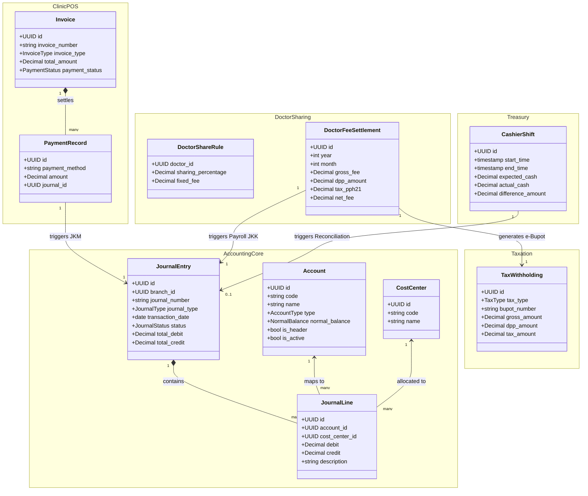
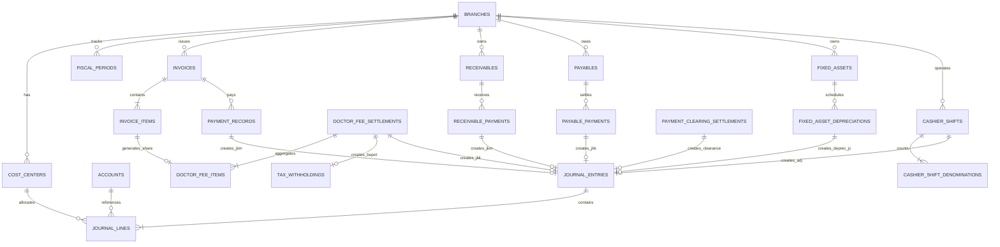

# PHASE 2 — ACCOUNTING DESIGN & DETAILED ARCHITECTURE
## Sistem ERP Akuntansi Terintegrasi: Kidinest (Poli Anak) & Semarang Skin Center (SSC)

Dokumen ini merupakan hasil rancangan arsitektur, diagram relasi entitas (ERD), matriks penjurnalan multi-jurnal, subsidiari ledger, dan perumusan laporan keuangan yang siap diimplementasikan pada **Phase 3 (Core Implementation)**.

---

## 1. Accounting Domain Diagram & Bounded Contexts

---

## 2. Entity-Relationship Diagram (ERD Akuntansi Lengkap)

---

## 3. Matriks Jurnal Transaksi Klinik Lengkap (Transaction-to-Journal Matrix)

| No | Peristiwa Bisnis Klinik | Akun DEBIT | Akun KREDIT | Jenis Jurnal | Keterangan & Bounded Context |
| :--- | :--- | :--- | :--- | :--- | :--- |
| **1** | Pasien Kidinest bayar pendaftaran, konsul, vaksin, obat via Tunai | `1-1111` Kas Kasir Kidinest | `4-1110` Pendapatan Registrasi `4-1120` Pendapatan Dokter Anak `4-1130` Pendapatan Tindakan Vaksin `4-1150` Pendapatan Obat Farmasi | `JKM` | **Kasir POS Kluster 1:** Kas masuk diakui seketika |
| **2** | Pengurangan stok vaksin & obat pasien Kidinest | `5-1120` HPP Vaksin Anak `5-1110` HPP Obat Resep Anak | `1-1311` Persediaan Vaksin `1-1310` Persediaan Obat Anak | `JU` | **Kasir POS Kluster 2:** Pemotongan stok FIFO *real-time* |
| **3** | Pengakuan beban bagi hasil dokter spesialis anak | `5-1210` Beban Bagi Hasil Dokter Anak | `2-1210` Hutang Jasa Medis Dokter | `JU` | **Kasir POS Kluster 3:** Akrual hak dokter per tindakan |
| **4** | Pasien SSC reservasi tindakan facial & krim skincare via EDC BCA | `1-1131` Piutang EDC Mesin Belum Settlement | `4-2110` Pendapatan Dokter Kulit `4-2130` Pendapatan Facial SSC `4-2140` Pendapatan Skincare SSC | `JKM` | **Kasir SSC Kluster 1:** Masuk akun transit EDC |
| **5** | Pemakaian krim skincare & bahan facial SSC | `5-2110` HPP Skincare Terjual `5-2120` HPP Bahan Facial | `1-1330` Persediaan Skincare `1-1331` Persediaan Bahan Facial | `JU` | **Kasir SSC Kluster 2:** Pemotongan stok krim/bahan |
| **6** | Akrual honor dokter kulit & komisi terapis SSC | `5-2210` Beban Bagi Hasil Dokter SSC `5-2220` Beban Komisi Terapis | `2-1220` Hutang Dokter SSC `2-1230` Hutang Komisi Terapis | `JU` | **Kasir SSC Kluster 3:** Akrual honor dokter & terapis |
| **7** | Pasien pulang dengan penjamin Asuransi / BPJS | `1-1220` Piutang Klaim Asuransi | `4-xxxx` Pos Pendapatan Layanan | `JU` | Pembentukan piutang asuransi |
| **8** | Klaim asuransi cair ditransfer ke Bank BCA | `1-1121` Bank BCA Operasional | `1-1220` Piutang Klaim Asuransi | `JKM` | Pelunasan piutang asuransi |
| **9** | Pembelian obat dari PBF Farmasi secara tempo (kredit) | `1-1310` Persediaan Obat Anak `1-1311` Persediaan Vaksin | `2-1110` Hutang Supplier Farmasi & PBF | `JB` / `JU` | Pembentukan hutang dagang supplier |
| **10** | Pembayaran tagihan faktur PBF via transfer Bank BCA | `2-1110` Hutang Supplier Farmasi & PBF | `1-1121` Bank BCA Operasional | `JKK` | Pelunasan hutang supplier |
| **11** | Pembayaran honor dokter akhir bulan & potong PPh 21 | `2-1210` / `2-1220` Hutang Jasa Medis Dokter | `2-1501.02` Hutang PPh 21 Dokter `1-1121` Bank BCA Operasional | `JKK` | Pencairan gaji dokter net via BCA |
| **12** | Setor PPh 21 Dokter ke Kas Negara via e-Billing | `2-1501.02` Hutang PPh 21 Dokter | `1-1121` Bank BCA Operasional | `JKK` | Pelunasan hutang pajak ke DJP |
| **13** | Tutup shift kasir: fisik uang kurang Rp 20.000 | `6-1700` Beban Selisih Kas Kasir | `1-1111` Kas Kasir Kidinest | `JC` | Penyesuaian selisih fisik kurang kasir |
| **14** | Tutup shift kasir: fisik uang lebih Rp 50.000 | `1-1111` Kas Kasir Kidinest | `4-9200` Pendapatan Selisih Kas Lebih | `JC` | Penyesuaian selisih fisik lebih kasir |
| **15** | Setoran fisik kas kasir harian ke rekening Bank BCA | `1-1121` Bank BCA Operasional | `1-1111` Kas Kasir Kidinest | `JB` | Mutasi transfer setoran kas ke bank |
| **16** | Settlement kliring EDC/QRIS cair ke BCA dipotong MDR | `1-1121` Bank BCA (Net) `6-1400` Beban Admin EDC/MDR | `1-1130` / `1-1131` Akun Kliring Transit (Bruto) | `JB` | Rekonsiliasi pencairan dana $T+1$ |
| **17** | Penyusutan bulanan mesin laser & peralatan medis | `6-1300` Beban Penyusutan Aset Tetap | `1-2900` Akumulasi Penyusutan Aset | `JC` | Cron job depresiasi akhir bulan |
| **18** | Tutup buku akhir tahun (Year-End Closing) | `4-xxxx` Akun Pendapatan (Nol-kan) `3-1300` Laba Berjalan (Net) | `5-xxxx` Akun HPP (Nol-kan) `6-xxxx` Akun Beban (Nol-kan) `3-1200` Laba Ditahan | `JT` | Penutupan akun nominal ke ekuitas |

---

## 4. Desain Subsidiari Ledger & Rekonsiliasi Akun Kontrol

Setiap buku besar akun kontrol (*Control Account*) wajib terekonsiliasi otomatis dengan buku pembantunya (*Subledger*):

1. **Buku Pembantu Piutang (*AR Subledger*) $\leftrightarrow$ Akun Kontrol `1-1200`:**
   - Dikelompokkan per Pasien dan per Perusahaan Asuransi.
   - Mutasi debit berasal dari Invoice kredit; mutasi kredit berasal dari `receivable_payments`.
   - Engine validasi: $\sum \text{Outstanding Subledger Pasien} \equiv \text{Saldo Akun 1-1200 pada Neraca Saldo}$.
2. **Buku Pembantu Hutang (*AP Subledger*) $\leftrightarrow$ Akun Kontrol `2-1110` & `2-1120`:**
   - Dikelompokkan per Supplier PBF Farmasi dan per Vendor Skincare.
   - Engine validasi: $\sum \text{Outstanding Faktur Supplier} \equiv \text{Saldo Akun 2-1110/2-1120 pada Neraca Saldo}$.
3. **Buku Pembantu Jasa Medis Dokter $\leftrightarrow$ Akun Kontrol `2-1210` & `2-1220`:**
   - Dikelompokkan per Nama & Spesialisasi Dokter.
   - Mengakumulasi nilai bruto jasa medis, tarif bagi hasil (70:30), potongan PPh 21, dan histori slip pembayaran honor.
4. **Buku Pembantu Persediaan FIFO (*Stock Card*) $\leftrightarrow$ Akun Kontrol `1-1310` s/d `1-1331`:**
   - Setiap kartu stok mencatat: Tanggal, No Batch, Expired Date, Masuk (Qty/HPP), Keluar (Qty/HPP), dan Sisa Saldo Nilai Uang.
   - Nilai akhir stok opnam fisik dikalikan harga perolehan FIFO wajib sama persis dengan saldo debit akun persediaan terkait.

---

## 5. Desain Modul Perpajakan (`clinic_pajak`)

1. **Aturan Perhitungan PPh 21 Dokter (PMK 168/2023):**
   - Tenaga Ahli Medis Bukan Pegawai Berkesinambungan.
   - $\text{DPP Kumulatif} = \sum (50\% \times \text{Bruto Jasa Medis})$.
   - Tarif Progresif Pasal 17 ayat (1) huruf a:
     - Lapisan 1 (0 s/d 60 Juta): 5%
     - Lapisan 2 (60 Juta s/d 250 Juta): 15%
     - Lapisan 3 (250 Juta s/d 500 Juta): 25%
     - Lapisan 4 (500 Juta s/d 5 Milyar): 30%
     - Lapisan 5 (> 5 Milyar): 35%
2. **Skema Ekspor e-Bupot 21/26 DJP:**
   - Menyediakan endpoint ekspor CSV/Excel siap impor ke aplikasi e-Bupot 21/26 DJP:
     - Masa Pajak & Tahun Pajak.
     - NIK/NPWP Dokter.
     - Kode Objek Pajak: `21-100-07` (Tenaga Ahli - Dokter).
     - Jumlah Penghasilan Bruto.
     - Jumlah DPP (50%).
     - Tarif Pajak (%).
     - PPh 21 Terutang Dipotong.
     - Tanggal Pemotongan & Nomor Bukti Potong.

---

## 6. Desain Alur Tutup Shift Kasir (*Cashier Shift & Treasury*)

1. **Buka Shift (*Open Shift*):**
   - Kasir login dan menginput modal kas awal (*float cash*, misal Rp 200.000).
   - Status shift `OPEN`.
2. **Operasional Transaksi:**
   - Setiap transaksi tunai masuk ke akun kasir spesifik (`1-1111` Kidinest atau `1-1112` SSC).
   - Transaksi non-tunai masuk ke transit EDC BCA (`1-1131`) atau QRIS (`1-1130`).
3. **Tutup Shift (*Close Shift*):**
   - Kasir menekan tombol "Tutup Shift".
   - Sistem membekukan total: Total Tunai Masuk, Total Transaksi EDC, Total QRIS.
   - Form *Physical Cash Count*: Kasir wajib menginput jumlah lembaran uang fisik (Rp 100k, 50k, 20k, 10k, 5k, 2k, 1k, koin).
   - Sistem membandingkan: $\text{Selisih} = \text{Kas Fisik Aktual} - \text{Kas Ekspektasi Sistem}$.
   - Jika ada selisih, sistem otomatis membuat Jurnal Penyesuaian (JC) ke `4-9200` (lebih) atau `6-1700` (kurang).
4. **Setoran Bank (*Bank Deposit*):**
   - Kasir menyerahkan amplop setoran tunai ke supervisor untuk disetor ke rekening Bank BCA (`1-1121`).
   - Sistem auto-posting Jurnal Bank (JB) memindahkan saldo kasir ke Bank BCA.

---

## 7. Desain Formula Laporan Keuangan Multi-Dimensi (Kidinest, SSC, Konsolidasi)

1. **Laporan Laba Rugi Berbasis Cost Center:**
   - Filter parameter: `cost_center = UNIT-KIDINEST`, `UNIT-SSC`, atau `ALL` (Konsolidasi).
   $$\text{Pendapatan Bersih} = \text{Pendapatan Bruto (4-xxxx)} - \text{Diskon & Potongan (4-9100)}$$
   $$\text{Laba Kotor} = \text{Pendapatan Bersih} - \text{HPP Obat/Vaksin/Skincare (5-xxxx)} - \text{Bagi Hasil Dokter (5-1210/5-2210)}$$
   $$\text{Laba Operasional} = \text{Laba Kotor} - \text{Beban Operasional Rutin (6-xxxx)}$$
   $$\text{Laba Bersih} = \text{Laba Operasional} + \text{Pendapatan Selisih Kas (4-9200)} - \text{Beban Selisih Kas (6-1700)} - \text{Beban Admin Bank (6-1400)}$$
2. **Laporan Neraca (*Balance Sheet*):**
   - Diambil *as-of-date*.
   $$\text{Total Aset} = \text{Aset Lancar (Kas/Bank + Piutang + Persediaan)} + \text{Aset Tetap Bersih (Harga Perolehan - Akum. Penyusutan)}$$
   $$\text{Total Liabilitas} = \text{Hutang Supplier (2-11xx)} + \text{Hutang Dokter (2-12xx)} + \text{Hutang Pajak (2-15xx)} + \text{Deposit Pasien (2-1410)}$$
   $$\text{Total Ekuitas} = \text{Modal Disetor (3-1100)} + \text{Laba Ditahan (3-1200)} + \text{Laba Periode Berjalan (Kumulatif Laba Bersih)}$$
   - Validasi ketat: $\text{Total Aset} \equiv \text{Total Liabilitas} + \text{Total Ekuitas}$.
3. **Laporan Arus Kas (*Cash Flow Statement*):**
   - **Arus Kas Aktivitas Operasi:** Penerimaan kasir pasien tunai/bank + penerimaan pelunasan piutang - pembayaran supplier PBF - pembayaran gaji & beban operasional - setoran pajak kas negara.
   - **Arus Kas Aktivitas Investasi:** Pembelian peralatan medis, mesin laser, renovasi klinik.
   - **Arus Kas Aktivitas Pendanaan:** Penyetoran modal pemilik, penarikan prive/dividen pemilik.
   - Saldo Akhir Kas = Saldo Awal + Kenaikan/Penurunan Bersih Kas.

