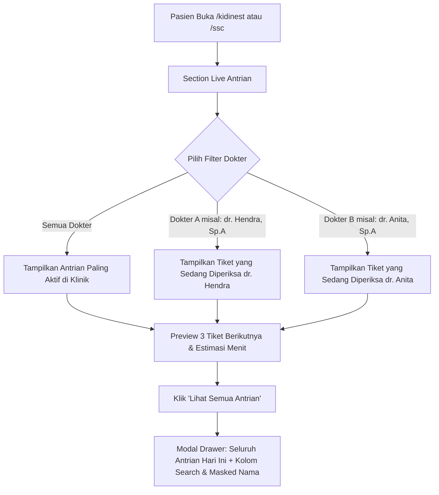

# Plan: Redesain Frontend Dual-Brand Kidinest & Semarang Skin Center (SSC)

Dokumen ini merumuskan rencana arsitektur dan UI/UX perombakan frontend Smart Clinic Management System (SCMS) sesuai permintaan dokter dan standar estetika **Design Taste Frontend** (anti-slop, clean typography, action-oriented hero, responsive segmented queue filter).

---

## 1. Ringkasan Kebutuhan & Problem Statement

| Kebutuhan Dokter / Klien | Kendala Saat Ini | Solusi Rombak UI & Flow |
| :--- | :--- | :--- |
| **Dual Front End (`/kidinest` & `/ssc`)** | Landing page saat ini masih tunggal dan generic dokter umum. | Routing dual-brand independen dengan kepribadian visual berbeda + Brand Switcher Top Bar. |
| **Hero Simpel & Kuat CTA** | Teks headline terlalu mendominasi (full text besar) minim tindakan cepat. | Hero ringkas, to the point, langsung mengarahkan user: Ambil Tiket Antrian / Cek Estimasi / Switch Brand. |
| **Live Antrian + 3 Antrian Berikutnya** | Ticker saat ini hanya menampilkan angka statis tanpa konteks dokter. | Kartu antrian live terintegrasi dokter yang memanggil + preview 3 antrian berikutnya (A-002, A-003, A-004). |
| **Filter Multi-Dokter** | Kidinest memiliki 2 dokter anak, SSC memiliki 2 dokter kulit. Pasien bingung melihat nomor antrian dokter mana yang sedang dipanggil. | **Segmented Control Filter Dokter** (Pill Tabs per dokter) yang langsung mengupdate live card & daftar tunggu. |
| **Lihat Semua Antrian** | Tampilan utama tidak boleh penuh sesak tabel panjang. | Tombol sekunder *"Lihat Semua Antrian"* yang membuka drawer/modal bersih dengan pencarian tiket pasien. |
| **Section Pendukung** | Informasi pendukung belum terstruktur rapi. | 4 section pendukung esensial: Profil & Jadwal Dokter, Layanan Unggulan, Lokasi & Jam Praktik, FAQ Tiket WhatsApp. |

---

## 2. Arsitektur Dual-Brand Routing & Visual Identity

### A. Route Mapping
* **`/` (Root):** Default redirect ke `/kidinest` dengan banner pemilih brand di bagian atas (`Semarang Skin Center ⇄ Kidinest`).
* **`/kidinest`:** Khusus Klinik Tumbuh Kembang & Pediatri (Poli Anak, Imunisasi, Fisioterapi Anak).
* **`/ssc`:** Khusus Semarang Skin Center (Estetika Medis, Dermatologi, Laser Skincare).
* **`/kiosk`:** Portal pendaftaran tiket mandiri pasien (dapat menerima query parameter `?brand=kidinest` atau `?brand=ssc`).
* **`/admin` & `/monitor`:** Workspace operasional staf dan layar monitor TV antrian klinik.

### B. Desain Brand Token (Estetika Nordic / Anti-Slop)

| Token | **Kidinest (Poli Anak & Tumbuh Kembang)** | **Semarang Skin Center (SSC - Estetika & Kulit)** |
| :--- | :--- | :--- |
| **Tone & Vibe** | Hangat, bersahabat, terpercaya, ramah anak tanpa kekanak-kanakan (Nordic Warmth). | Bersih, presisi, klinis mewah, elegan, minimalis (Clinical Aesthetic). |
| **Canvas Background** | Warm Off-White (`#FBFBF9`) | Pure Porcelain Zinc (`#FAFAFA`) |
| **Primary Accent** | Deep Pine Emerald (`#0F4C3A`) + Warm Amber (`#F59E0B`) | Slate Charcoal (`#18181B`) + Soft Rose/Mauve (`#E11D48` / `#BE185D`) |
| **Typography** | Plus Jakarta Sans (Rounded geometric, legible, human) | Plus Jakarta Sans + Inter (Sharp, elegant, tracking tight) |
| **Badge / Tag** | Pill Badge Soft Amber/Emerald (`bg-emerald-50 text-emerald-800`) | Pill Badge Soft Rose/Zinc (`bg-zinc-100 text-zinc-900 border-zinc-200`) |

---

## 3. Solusi UX: Filter Antrian Multi-Dokter & Live Preview

### Diagram Alur Interaksi Filter Antrian

### Komponen Section Antrian (Anti-Clutter)
1. **Header Filter (Pill Tab Switcher):**
   * *Contoh Kidinest:* `[Semua Dokter]` • `[dr. Hendra Pratama, Sp.A (Ruang 1)]` • `[dr. Anita Ratna, Sp.A (Ruang 2)]`
   * *Contoh SSC:* `[Semua Dokter]` • `[dr. Dian Paramita, Sp.DV (Ruang Estetika)]` • `[dr. Kevin Wijaya, Sp.KK (Ruang Tindakan)]`
   * Badge indikator hijau dot `● Sedang Praktik` pada dokter yang sedang aktif melayani.
2. **Kartu Utama "Sedang Diperiksa":**
   * Menampilkan nomor besar (misal: `K-007` untuk Kidinest atau `S-004` untuk SSC).
   * Status dokter & ruangan yang memanggil.
   * Nama pasien disamarkan demi privasi (misal: `Ananda R****`).
3. **Kartu "3 Antrian Berikutnya" (Next In Line):**
   * Tiga kartu ringkas berdampingan (`K-008`, `K-009`, `K-010`).
   * Perkiraan waktu panggil (misal: `~5 mnt lagi`, `~15 mnt lagi`).
4. **Action "Lihat Semua Antrian" (Drawer Modal):**
   * Tombol sekunder yang elegan: `"Lihat Daftar Lengkap (12 Pasien) →"`
   * Membuka modal bersih berisi list nomor tiket, status (`Menunggu`, `Diperiksa`, `Farmasi`), dan form pencarian nomor tiket cepat.

---

## 4. Struktur Rombak Halaman (One Screen per Section Standard)

### Section 1: Hero Section (Simpel, Action-Driven)
* **Top Navigation Bar:**
  * Logo Brand Aktif (`Kidinest` atau `Semarang Skin Center`).
  * **Brand Switcher Pill:** `Beralih ke Semarang Skin Center ↗` (atau sebaliknya).
  * Menu Cepat: `Live Antrian` • `Jadwal Dokter` • `Layanan` • `Lokasi`.
  * Tombol CTA Primer: `Daftar Antrian Online`.
* **Hero Content (Clean & Direct):**
  * Kategori pill: `Poli Spesialis Anak & Vaksinasi Modern` / `Pusat Kesehatan Kulit & Estetika Terpadu`.
  * Headline padat (maks 2 baris):
    * *Kidinest:* *"Pemeriksaan Buah Hati Tanpa Antri Lama."*
    * *SSC:* *"Kesehatan Kulit Presisi dengan Dokter Spesialis."*
  * Sub-headline (1-2 baris penjelasan manfaat praktis).
  * **Dual Action Buttons:**
    1. Primary CTA: `Ambil Nomor Antrian Sekarang →` (langsung membuka form pendaftaran cepat / kiosk).
    2. Secondary CTA: `Pantau Antrian Hari Ini ↓` (scroll halus ke section live antrian).

### Section 2: Live Queue Widget (Interactive Multi-Doctor Filter)
* Segmented control tab pemilihan dokter.
* Box status aktif + 3 kartu antrian berikutnya.
* Drawer modal detail seluruh antrian hari ini.
* Banner edukasi: *"Dapatkan notifikasi panggil via WhatsApp otomatis saat nomor Anda mendekati giliran."*

### Section 3: Tim Dokter Spesialis & Jadwal Praktik
* Kartu profil dokter ringkas (Foto dokter realistis, nama gelar lengkap, spesialisasi, jam praktik hari ini).
* Tombol instan per dokter: `Daftar ke Dokter Ini`.

### Section 4: Layanan Unggulan & Fasilitas
* 3-4 pilar layanan utama dengan kartu bersih border halus (tanpa icon kartun over-gradient).
* *Kidinest:* Tumbuh Kembang, Vaksinasi Lengkap Anak, Skrining Alergi, Fisioterapi Pediatri.
* *SSC:* Laser Rejuvenation, Acne & Scar Solution, Medical Facial, Skin Pathology & Surgery.

### Section 5: Lokasi, Jam Praktik & Kontak Terpadu
* Alamat jelas, jam buka poli pagi & sore, peta akses, integrasi tombol WhatsApp Customer Care.

### Section 6: Footer & Role Switcher
* Informasi hak cipta & perizinan klinik.
* Switcher tersembunyi/discreet untuk presentasi klien ke ruang staf (`Staf Meja Depan`, `Ruang Dokter`, `Apotek`).

---

## 5. Rencana File & Tahapan Eksekusi

### File yang Dibuat / Dimodifikasi:
1. `frontend/src/views/LandingKidinest.vue` (Komponen landing Kidinest anak)
2. `frontend/src/views/LandingSSC.vue` (Komponen landing Semarang Skin Center)
3. `frontend/src/components/LiveQueueFilter.vue` (Komponen reusable live queue dengan segmented multi-dokter filter)
4. `frontend/src/components/BrandSwitcherHeader.vue` (Header dual brand responsif)
5. `frontend/src/App.vue` (Update router internal untuk menangani `/kidinest` dan `/ssc`)
6. `frontend/src/stores/clinic.ts` & mock data (Update daftar dokter Kidinest & SSC agar realistis saat demo)

### Verifikasi & Standar Keberhasilan:
* Build `npm run build` sukses 0 error / warning TypeScript.
* Transisi antara `/kidinest` dan `/ssc` berjalan mulus seketika tanpa page reload.
* Filter dokter mengubah kartu live queue dan 3 kartu berikutnya secara reaktif.
* Tombol *"Lihat Semua Antrian"* menampilkan modal drawer yang responsif di mobile & desktop.
* Tidak ada visual generic AI slop: desain mematuhi aturan tipografi, kontras warna tinggi, dan spacing proporsional.

---
*Status: Siap dieksekusi setelah konfirmasi pengguna.*
