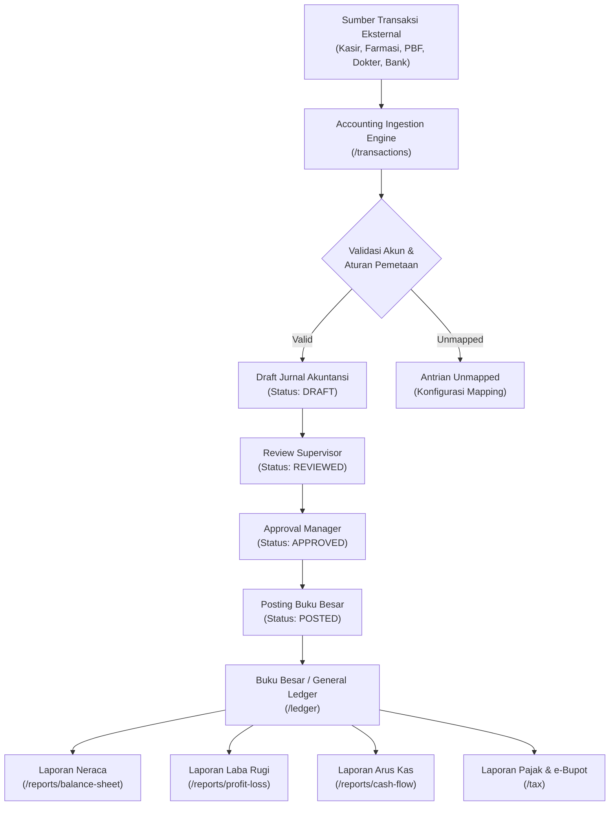

# PRODUCT REQUIREMENTS DOCUMENT (PRD) & SPESIFIKASI TEKNIS FRONTEND
## SISTEM ERP AKUNTANSI TERINTEGRASI MULTI-UNIT
### Unit Bisnis: Kidinest (Pediatrik) & Semarang Skin Center (Dermatologi & Estetika)

---

| Dokumen | Spesifikasi Kebutuhan Produk (PRD) Frontend Akuntansi |
| :--- | :--- |
| **Versi Produk** | v1.0.0 (Enterprise Production-Ready) |
| **Target Pengguna** | Staf Akuntansi, Supervisor Keuangan, Finance Manager, Direksi Klinik |
| **Arsitektur Frontend** | Vue 3 + TypeScript + Vite + Tailwind CSS + Pinia |
| **Unit Bisnis** | 1. **Kidinest** (Poli Spesialis Anak, Imunisasi, Tumbuh Kembang, Farmasi)<br>2. **Semarang Skin Center (SSC)** (Dermatologi, Laser Medis, Facial, Skincare) |
| **Prinsip Akuntansi** | Double-Entry Bookkeeping, Dual Control Review/Approval, PSAK/IFRS, PMK 168/2023 |

---

## 1. LATAR BELAKANG & TUJUAN PRODUK

### 1.1 Latar Belakang
Klinik Kidinest dan Semarang Skin Center (SSC) beroperasi di bawah satu payung manajemen dengan karakteristik bisnis medis yang berbeda namun membutuhkan sistem pembukuan terpusat:
- **Kidinest**: Pelayanan spesialis anak, vaksinasi berjadwal, terapi tumbuh kembang, dan resep farmasi pediatrik dengan volume transaksi harian tinggi.
- **Semarang Skin Center (SSC)**: Pelayanan dermatologi estetika, tindakan medis laser (Nd:YAG/Cauter), paket perawatan facial beautician, serta penjualan produk skincare retail.

Sistem akuntansi ini berfokus secara eksklusif pada **pencatatan akuntansi, manajemen jurnal, buku besar, laporan keuangan hierarki, dan kepatuhan pajak medis**. Sistem tidak membuat aplikasi kasir atau farmasi POS baru, melainkan bertindak sebagai gerbang terintegrasi (*accounting ingest & posting engine*) yang menerima data operasional dari kasir, farmasi, pembelian, dan dokter.

### 1.2 Prinsip Inti Akuntansi (*Core Accounting Principles*)
1. **Traceability**: Setiap transaksi jurnal wajib memiliki tautan dokumen sumber asal (*source document reference*).
2. **Double-Entry Balance**: Setiap voucher jurnal wajib seimbang secara matematis (Total Debet = Total Kredit). Jurnal tidak seimbang ditolak oleh validasi sistem.
3. **Dual Control Workflow**:
   - Pembuatan draf jurnal dilakukan oleh Staf Akuntansi.
   - Peninjauan teknis dilakukan oleh Accounting Supervisor.
   - Persetujuan akhir dan posting dilakukan oleh Finance & Accounting Manager.
4. **Immutability of Posted Records**: Jurnal yang telah berstatus `POSTED` terkunci secara permanen dan tidak dapat diedit atau dihapus. Koreksi hanya dapat dilakukan melalui jurnal pembalik (*reversal journal*).
5. **Hierarchical Multi-Level Reporting**: Laporan keuangan disajikan dalam format tabel pohon hierarki (*tree table*) dengan tingkat kedalaman Level 1 sampai Level 4 dan kemampuan drill-down ke Buku Besar.

---

## 2. ARSITEKTUR ALUR TRANSAKSI (TRANSACTION WORKFLOW)



---

## 3. SPESIFIKASI MODUL & FITUR FRONTEND

### 3.1 Dasbor Ikhtisar Keuangan (`/dashboard`)
- **KPI Finansial Utama**: Total Pendapatan, Total Beban, Laba Bersih, Saldo Kas & Bank, Piutang Pasien, Hutang Usaha, Nilai Persediaan.
- **Distribusi Jurnal**: Monitoring jumlah voucher DRAFT, REVIEWED, APPROVED, dan POSTED secara *real-time*.
- **Grafik Interaktif**:
  - Tren Laba Bersih Bulanan.
  - Perbandingan Pendapatan Kidinest vs. SSC.
  - Komposisi Beban Operasional.
- **Filter Global**: Business Unit Switcher (`ALL`, `KIDINEST`, `SSC`) dan Pemilih Periode Akuntansi.

---

### 3.2 Modul Sumber Transaksi Operasional (`/transactions`)
- **Fungsi**: Menerima feed transaksi dari POS Kasir, Billing Pasien, Pembelian PBF, dan Honor Dokter.
- **Kategori Sumber**:
  1. *Cashier Closing*: Penutupan kasir shift harian (uang tunai, EDC, QRIS).
  2. *Patient Billing*: Tagihan tindakan rawat jalan dan klaim asuransi.
  3. *Pharmacy Purchase*: Pembelian obat dan vaksin dari distributor PBF.
  4. *Doctor Fee*: Honorarium bagi hasil dokter spesialis (Sp.A dan Sp.DVE).
  5. *Payroll*: Gaji tenaga medis, perawat, apoteker, dan staf.
  6. *Bank & Settlement*: Kliring batch EDC dan transfer perbankan.
- **Aksi Transaksi**:
  - Validasi kelengkapan akun.
  - *Generate Draft Journal* otomatis berdasarkan *mapping rules*.
  - Pencegahan duplikasi jurnal untuk satu nomor referensi operasional.

---

### 3.3 Modul Manajemen Jurnal (`/journals` & `/journals/approvals`)
- **Daftar Jurnal Umum**: Pencarian voucher jurnal berdasarkan nomor jurnal, tanggal, unit bisnis, dan status.
- **Antrian Review & Approval**:
  - Tampilan khusus bagi Supervisor dan Manager untuk verifikasi dual control.
  - Tombol Review Jurnal, Approve Jurnal, dan Post Jurnal.
- **Modal Pembuatan Jurnal Manual**:
  - Input multi-baris dinamis.
  - Auto-calculation total debet dan total kredit secara real-time.
  - Proteksi validasi: tombol simpan dinonaktifkan jika debet != kredit.
- **Modal Voucher Jurnal Detail**:
  - Menampilkan informasi nomor jurnal, referensi asal, audit trail (Dibuat, Direview, Disetujui, Diposting).
  - Tabel rincian debit/kredit per akun.
  - Tombol cetak voucher (*Print Layout*).
  - Mekanisme Jurnal Pembalik (*Reversal*) dengan kewajiban mengisi alasan pembatalan.

---

### 3.4 Modul Laporan Neraca / Balance Sheet (`/reports/balance-sheet`)
- **Desain Tampilan**: High-contrast Enterprise SaaS Dark Theme (`#121826`, `#0F172A`) terinspirasi ERP Brayo reference.
- **Penghapusan Kolom Tanda Tangan**: Blok tanda tangan manual resmi ditiadakan dari tampilan web sesuai instruksi.
- **Struktur Hierarki 4-Level**:
  - **Level 1**: Header Akun Utama (`AKTIVA`, `KEWAJIBAN DAN MODAL`).
  - **Level 2**: Pos Akun Kelompok (`11 - KAS DAN BANK`, `12 - PIUTANG`, `13 - Persediaan`, `14 - INVESTASI`, `15 - BIAYA DIBAYAR DI MUKA`, `16 - AKTIVA TETAP`, `KEWAJIBAN`, `EKUITAS`).
  - **Level 3**: Sub-Akun (`Kas Kasir Kidinest`, `Bank BCA Operasional`, `Piutang Asuransi`, `Hutang Dagang PBF`, dll.).
  - **Level 4**: Akun Detail Buku Besar / Leaf Accounts.
- **Nomor Urut Baris (Line Index)**: Baris diberi nomor indeks konsisten (Baris 3: NERACA, Baris 4: PER 30 NOVEMBER 2026, Baris 6: AKTIVA, Baris 7: KAS DAN BANK, dst.).
- **Bilah Kontrol Level di Bagian Bawah**:
  - Input level numerik dengan tombol **`[Set Level]`**.
  - Tombol cepat: **`[Lvl 1]`**, **`[Lvl 2]`**, **`[Lvl 3]`**, **`[Lvl 4 (Detail)]`**.
  - Tombol **`[Expand All]`** dan **`[Collapse All]`**.
- **Drill-down ke Buku Besar**: Ikon buku (`📖`) pada setiap baris akun membuka Buku Besar akun terkait.

---

### 3.5 Modul Laporan Laba Rugi / Profit & Loss (`/reports/profit-loss`)
- **Struktur Laporan**:
  1. `PENDAPATAN`: Pendapatan Poli Anak, Tindakan Imunisasi, Tindakan Laser SSC, Treatment Facial, Penjualan Skincare.
  2. `BIAYA (HPP & BEBAN OPERASIONAL)`: HPP Obat Resep, HPP Vaksin, HPP Skincare, Bagi Hasil Dokter Medis (Sp.A & Sp.DVE), Biaya Marketing, Beban Umum & Administrasi.
  3. `PENDAPATAN LAIN-LAIN`: Pendapatan Bunga Bank, Pendapatan Selisih Kasir.
  4. `BIAYA LAIN-LAIN`: Beban Administrasi Bank, Biaya Bunga Pinjaman, Pajak Jasa Giro.
  5. `LABA(RUGI) SEBELUM PAJAK`: Rekonsiliasi laba bersih operasional.
- **Kontrol & Navigasi**: Bilah pemilih level (`Lvl 1`..`Lvl 4`), Expand/Collapse All, dan link drill-down ke Buku Besar.

---

### 3.6 Modul Laporan Arus Kas / Cash Flow Statement (`/reports/cash-flow`)
- **Metode**: Metode Langsung (*Direct Method*).
- **Format Tabel**:
  - Kolom Nomor Baris (Line 8 s/d 39).
  - Kolom Komparasi Multi-Periode (*November 2026* vs. *November 2025*).
- **Klasifikasi Arus Kas**:
  1. *Arus Kas dari Aktivitas Operasi*: Penyesuaian penyusutan, perubahan modal kerja (persediaan, piutang, hutang uang muka, hutang dagang, bagi hasil dokter, hutang pajak).
  2. *Arus Kas dari Aktivitas Investasi*: Pengadaan aset tetap peralatan laser dan USG 4D.
  3. *Arus Kas dari Aktivitas Pendanaan*: Tambahan modal dan pelunasan pinjaman.
  4. *Kenaikan (Penurunan) Kas Bersih*.
  5. *Rekonsiliasi Kas Awal dan Kas Akhir Periode*.
- **Tautan Akun**: Teks akun berwarna biru dapat diklik langsung untuk membuka riwayat transaksi buku besar.

---

### 3.7 Modul Buku Besar / General Ledger (`/ledger`)
- **Konsep "Keseluruhan Transaksi"**:
  - Menampilkan seluruh daftar mutasi jurnal secara kronologis untuk akun yang dipilih.
  - Mendukung akun header dan akun detail melalui kamus alias otomatis.
  - Generator transaksi realistis mencakup 18+ transaksi sepanjang bulan berjalan jika jurnal backend belum diposting.
- **Informasi Kartu Akun**: Kode Akun, Nama Akun, Tipe Akun, Saldo Normal (Debit/Kredit), Unit Bisnis, Saldo Awal, Total Debet, Total Kredit, dan Saldo Akhir.
- **Tabel Transaksi**:
  - Kolom: Nomor Urut (`#`), Tanggal, Nomor Jurnal, Sumber Modul, Deskripsi/Memo Transaksi, Unit Bisnis, Debet, Kredit, Saldo Berjalan (*Running Balance*).
  - Saldo berjalan dihitung dinamis baris demi baris mengikuti kaidah saldo normal akun.
  - Filter pencarian instan di dalam tabel (*in-table search*) berdasarkan memo atau no jurnal.
  - Tombol intip jurnal (*Eye icon*) untuk membuka voucher double-entry.

---

### 3.8 Modul Buku Kas & Bank (`/cash-bank`)
- **Buku Kas Kasir**: Kas Kasir Kidinest (`1-1111`), Kas Kasir SSC (`1-1112`), Kas Kecil/Petty Cash (`1-1113`).
- **Buku Rekening Bank**: Bank BCA Operasional (`1-1121`), Bank Mandiri Operasional (`1-1122`), Kliring QRIS/EDC Transit (`1-1130`).
- **Monitoring Likuiditas**: Kartu ringkasan total uang tunai aktif dan total saldo bank.

---

### 3.9 Modul Analisis Umur Piutang (AR) & Hutang (AP) (`/reports/aging`)
- **Aging Piutang Pasien & Asuransi**:
  - Monitoring jatuh tempo klaim asuransi Sinarmas, Prudential, dan MCU Korporat Astra.
  - Bucket umur: Lancar, 1-30 hari, 31-60 hari, 61-90 hari, >90 hari.
- **Aging Hutang Supplier Farmasi**:
  - Monitoring faktur tempo distributor obat PT Kimia Farma Trading, Kalbe Farma, dan supplier bahan skincare.

---

### 3.10 Modul Manajemen Pajak Medis (`/tax`)
- **Kalkulasi PPh Pasal 21 Dokter Tenaga Ahli**:
  - Mengikuti regulasi **PMK No. 168/2023** dan **UU HPP**.
  - DPP = 50% dari honor bruto kumulatif.
  - Penerapan tarif progresif Pasal 17 UU PPh (5%, 15%, 25%, 30%, 35%).
- **Rekapitulasi PPN Medis & Estetika**:
  - PPN Keluaran 11% atas penjualan krim kosmetika retail dan treatment non-medis beautician.
  - PPN Masukan dari faktur pajak distributor farmasi.
- **Ekspor DJP e-Bupot**: Ekspor file CSV standar DJP untuk pelaporan SPT Masa PPh 21/26.

---

### 3.11 Modul Bagan Akun Standar / Chart of Accounts (`/chart-of-accounts`)
- Struktur hierarki 4 level klasifikasi PSAK Indonesia:
  - `1-0000`: Aset / Aktiva
  - `2-0000`: Kewajiban / Liabilitas
  - `3-0000`: Ekuitas / Modal
  - `4-0000`: Pendapatan Operasional & Non-Operasional
  - `5-0000`: Harga Pokok Penjualan (HPP) & Bagi Hasil Medis
  - `6-0000`: Beban Operasional, Umum & Administrasi
- Modal tambah akun baru dan filter berdasarkan tipe akun.

---

## 4. STANDAR TEKNIS & KONTRAK INTEGRASI BACKEND

### 4.1 Parameter Standar Request API List
Sesuai standar backend pagination dan filtering, semua endpoint list mengonsumsi parameter:
```typescript
export interface StandardListParams {
  page: number          // Default: 1, Min: 1
  limit: number         // Default: 20, Max: 100
  search?: string       // Filter teks pada kolom terindeks
  sort_by?: string      // Kolom sorting whitelist (e.g., 'journal_date', 'created_at')
  sort_order?: 'asc' | 'desc' // Arah sorting (default: 'desc')
  business_unit_id?: string   // 'ALL' | 'KIDINEST' | 'SSC'
  branch_id?: string          // ID Cabang klinik
  start_date?: string         // Format YYYY-MM-DD
  end_date?: string           // Format YYYY-MM-DD
  status?: string             // Status transaksi atau jurnal
}
```

### 4.2 Struktur Standar Response API
```json
{
  "success": true,
  "message": "Data transaksi berhasil diambil",
  "data": [ ... ],
  "meta": {
    "page": 1,
    "limit": 20,
    "total_records": 142,
    "total_pages": 8
  }
}
```

---

## 5. KEAMANAN, OTORISASI & AUDIT TRAIL

1. **Prinsip Dual Control**: Mencegah kecurangan (*fraud*) dengan memisahkan wewenang staf yang membuat draf jurnal dari supervisor dan manajer yang menyetujui jurnal.
2. **Multi-Tenancy Unit**: Data unit Kidinest dan SSC terisolasi secara logis melalui parameter `business_unit` namun dapat dikonsolidasikan oleh level manajemen eksekutif.
3. **Audit Log Tak Terhapus (`/audit-trail`)**: Setiap aktivitas posting, review, approval, dan pembalikan jurnal mencatat timestamp, user ID, IP address, status sebelum, dan status sesudah.
4. **Validasi Tanpa Docker**: Aplikasi dan service berjalan penuh secara native di lingkungan pengembangan macOS (PostgreSQL 14 Homebrew port 5432, Go API port 8080, Vite dev server port 5173).

