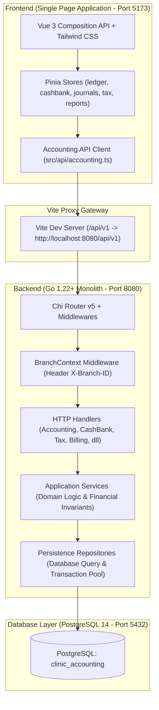
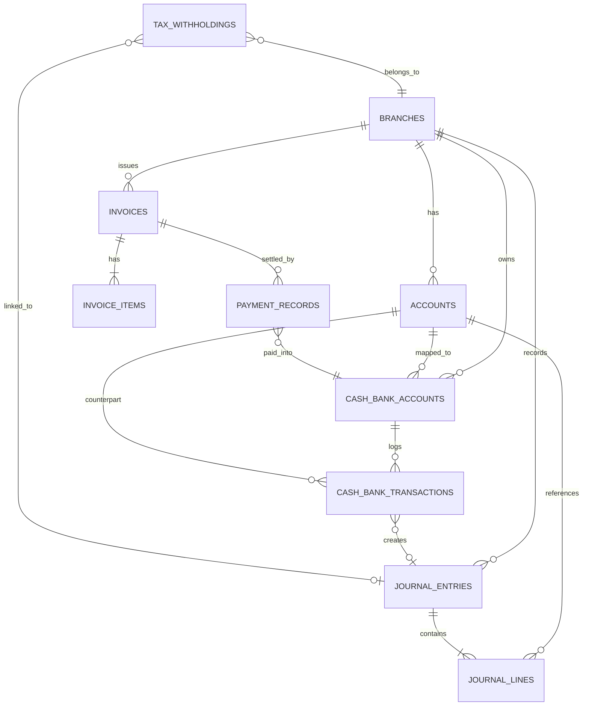
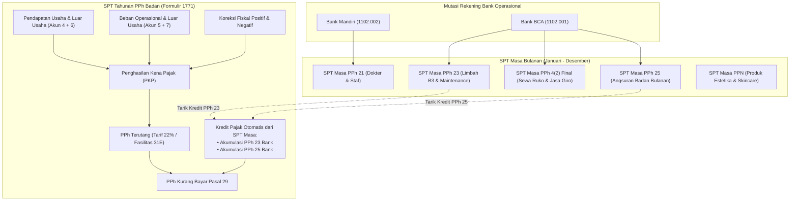

# 📘 DOKUMENTASI SISTEM LENGKAP: BACKEND & FRONTEND
## Sistem Informasi Manajemen Klinik & ERP Akuntansi Terpadu (Smart Clinic OS - BCS)
**PT. Brayo Cipta Sejahtera (Klinik Pratama Kidinest & Samarinda Skin Center)**

---

## DAFTAR ISI
1. [Ringkasan Eksekutif & Arsitektur Global](#1-ringkasan-eksekutif--arsitektur-global)
2. [Arsitektur Backend (Go Modular Monolith)](#2-arsitektur-backend-go-modular-monolith)
3. [Arsitektur Database & Skema PostgreSQL](#3-arsitektur-database--skema-postgresql)
4. [Bagan Akun Standar BCS (Chart of Accounts - 106 Akun)](#4-bagan-akun-standar-bcs-chart-of-accounts---106-akun)
5. [Katalog Lengkap REST API Endpoints](#5-katalog-lengkap-rest-api-endpoints)
6. [Arsitektur Frontend (Vue 3 + Pinia + Tailwind CSS)](#6-arsitektur-frontend-vue-3--pinia--tailwind-css)
7. [Modul Finansial & Aturan Bisnis Akuntansi Khusus](#7-modul-finansial--aturan-bisnis-akuntansi-khusus)
   - 7.1 [Buku Kas & Bank Mandiri (Manual & Auto-Sync)](#71-buku-kas--bank-mandiri-manual--auto-sync)
   - 7.2 [Sistem Perpajakan DJP: SPT Masa & SPT Tahunan Bank-Only](#72-sistem-perpajakan-djp-spt-masa--spt-tahunan-bank-only)
   - 7.3 [Pembuatan Saldo Awal (Opening Balance Engine)](#73-pembuatan-saldo-awal-opening-balance-engine)
   - 7.4 [Jurnal Umum & Double-Entry Invariant](#74-jurnal-umum--double-entry-invariant)
8. [Panduan Operasional & Menjalankan Sistem (Native Local Run)](#8-panduan-operasional--menjalankan-sistem-native-local-run)
9. [Jejak Perbaikan, Troubleshooting & Catatan Teknis](#9-jejak-perbaikan-troubleshooting--catatan-teknis)

---

## 1. RINGKASAN EKSEKUTIF & ARSITEKTUR GLOBAL

Sistem Informasi Manajemen Klinik & ERP Akuntansi Terpadu PT. Brayo Cipta Sejahtera (BCS) adalah platform monolitik modern yang menggabungkan operasional klinis fasilitas kesehatan (Klinik Pratama Kidinest untuk Pediatri & Samarinda Skin Center untuk Dermatologi/Estetika) dengan modul akuntansi komprehensif berstandar PSAK dan regulasi perpajakan Direktorat Jenderal Pajak (DJP).



### Karakteristik Desain Utama
1. **Performa Tinggi & Sub-10ms Latency:** Backend ditulis dalam bahasa Go (Golang) murni menggunakan HTTP Router Chi v5 yang ringan dan idiomatik.
2. **Koneksi Database PostgreSQL Native:** Seluruh data keuangan, bagan akun (COA), transaksi kas & bank, jurnal umum, bukti potong pajak, dan saldo awal tersimpan secara persisten pada PostgreSQL 14 (bukan mock/hardcoded).
3. **Multi-Unit & Multi-Branch Ready:** Menggunakan context header `X-Branch-ID` (Default: `11111111-1111-1111-1111-111111111111` untuk Head Office / Kidinest / SSC).
4. **Antarmuka Modern Nordic Minimalist:** Vue 3, Vite 6, Tailwind CSS dengan estetika bersih kanvas `#F9F9F7`, tipografi terstruktur, bebas dependensi CSS berat.
5. **Kepatuhan Akuntansi & Pajak Ketat:**
   - Invarian *Double-Entry* seimbang (`Total Debit == Total Credit`).
   - Penomoran jurnal anti-tabrakan nanodetik (`JRN-YYYYMMDD-XXXXXXX`).
   - SPT Tahunan Badan (Formulir 1771) otomatis menarik data akumulasi kredit pajak dari SPT Masa (PPh 23 dan PPh 25).
   - Pengambilan basis pajak dan kredit pajak secara ketat **hanya dari mutasi Bank (Non-Tunai)** sesuai aturan administrasi perpajakan fiskal.

---

## 2. ARSITEKTUR BACKEND (GO MODULAR MONOLITH)

Struktur backend disusun menggunakan prinsip Clean Architecture & Modular Monolith yang memisahkan ranah *domain*, *application services*, *persistence adapters*, dan *HTTP transport*.

### Struktur Direktori Backend
```
backend/
├── cmd/
│   ├── api/
│   │   └── main.go              # Entry point REST API server
│   ├── migrate/
│   │   └── main.go              # Database migration runner
│   └── worker/
│       └── main.go              # Background asynchronous worker
├── configs/
│   ├── config.go                # Environment & YAML loader
│   └── config.yaml.example      # Template konfigurasi
├── internal/
│   ├── adapters/
│   │   └── persistence/         # PostgreSQL database queries & repositories
│   ├── application/             # Core business logic services
│   │   ├── accounting/          # COA, Opening Balance, Account creation
│   │   ├── cashbank/            # Cash drawer, Bank mutation, Transfer
│   │   ├── journal/             # General Journal, Posting, Reversal
│   │   ├── tax/                 # Tax calculation, e-Bupot, SPT Masa & Tahunan
│   │   ├── billing/             # Patient billing & POS invoicing
│   │   ├── doctorshare/         # Jasa medis dokter & fee settlement
│   │   ├── reporting/           # GL, Neraca Saldo, Laba Rugi, Neraca, Arus Kas
│   │   ├── treasury/            # Shift kasir & rekonsiliasi brankas
│   │   ├── asset/               # Aset tetap & penyusutan bulanan
│   │   ├── prepaid/             # Biaya dibayar dimuka & amortisasi
│   │   ├── budget/              # Anggaran pusat biaya & variance
│   │   └── audit/               # Jejak audit transaksi finansial
│   ├── domain/                  # Entities, Value Objects, & Enums
│   │   ├── accounting/          # Account, JournalEntry, JournalLine
│   │   ├── cashbank/            # CashBankAccount, CashBankTransaction
│   │   ├── tax/                 # TaxWithholding, TaxPeriod
│   │   ├── billing/             # Invoice, InvoiceItem, PaymentRecord
│   │   └── master/              # Branch, CostCenter, FiscalPeriod
│   ├── transport/
│   │   └── http/
│   │       ├── dto/             # Request & Response Data Transfer Objects
│   │       ├── handler/         # HTTP Controller handlers
│   │       ├── middleware/      # BranchContext, Auth, CORS, Logger
│   │       └── routes/          # Chi route registration per domain
│   └── bootstrap/
│       ├── app.go               # Server lifecycle & graceful shutdown
│       ├── container.go         # Dependency injection wireup
│       ├── database.go          # Database connection pool initializer
│       └── logger.go            # Structured logging
├── migrations/                  # SQL Schema migrations (000001 - 000007)
├── seeds/                       # Seed SQL files (bcs_coa_and_accounting_seed.sql)
└── pkg/
    ├── response/                # JSON standard envelope builder
    ├── pagination/              # Dynamic limit/offset & pagination math
    └── decimal/                 # Fixed-point currency arithmetic
```

---

## 3. ARSITEKTUR DATABASE & SKEMA POSTGRESQL

Database PostgreSQL (`clinic_accounting`) dirancang dengan relasi integritas referensial penuh (Foreign Keys) dan UUID sebagai Primary Key.



### Tabel-Tabel Inti Akuntansi

#### 1. `accounts` (Bagan Akun - COA)
Menyimpan 106 akun hierarki 4-tingkat milik PT. Brayo Cipta Sejahtera.
| Kolom | Tipe Data | Keterangan |
| :--- | :--- | :--- |
| `id` | UUID (PK) | Unique Identifier Akun |
| `code` | VARCHAR(50) (UNIQUE) | Kode Akun (contoh: `1101.001`, `4101`) |
| `name` | VARCHAR(255) | Nama Akun Resmi |
| `type` | VARCHAR(20) | `ASSET`, `LIABILITY`, `EQUITY`, `REVENUE`, `COGS`, `EXPENSE` |
| `normal_balance` | VARCHAR(10) | `DEBIT` atau `CREDIT` |
| `parent_id` | UUID (FK `accounts.id`) | Induk hierarki akun (NULL untuk level 1) |
| `level` | INT | Tingkat kedalaman hierarki (1 s/d 4) |
| `is_header` | BOOLEAN | `TRUE` jika akun rekapitulasi, `FALSE` jika akun posting |
| `is_active` | BOOLEAN | Status aktif akun |
| `description` | TEXT | Keterangan fungsi akun |

#### 2. `cash_bank_accounts` (Rekening Kas & Bank Terdaftar)
Menyimpan akun perbendaharaan operasional (Kasir Kidinest, Kasir SSC, Petty Cash, Bank BCA, Bank Mandiri, QRIS Transit).
| Kolom | Tipe Data | Keterangan |
| :--- | :--- | :--- |
| `id` | UUID (PK) | Identifier Rekening |
| `branch_id` | UUID (FK `branches.id`) | Cabang kepemilikan rekening |
| `account_id` | UUID (FK `accounts.id`) | Relasi ke akun buku besar pada tabel `accounts` |
| `code` | VARCHAR(50) (UNIQUE) | Kode kas/bank (`KAS-KIDINEST`, `BANK-BCA`, dll) |
| `name` | VARCHAR(255) | Nama rekening operasional |
| `type` | VARCHAR(20) | Tipe rekening (`CASH` atau `BANK`) |
| `bank_name` | VARCHAR(100) | Nama bank (BCA, Mandiri, atau NULL untuk Kas) |
| `account_number` | VARCHAR(50) | Nomor rekening fisik / giro bank |
| `current_balance` | NUMERIC(15,2) | Saldo berjalan rekening |
| `is_active` | BOOLEAN | Status operasional |

#### 3. `cash_bank_transactions` (Mutasi Kas & Bank)
Mencatat seluruh pemasukan, pengeluaran, dan transfer antar kas/bank.
| Kolom | Tipe Data | Keterangan |
| :--- | :--- | :--- |
| `id` | UUID (PK) | Identifier Transaksi |
| `branch_id` | UUID (FK `branches.id`) | Cabang transaksi |
| `cash_bank_account_id`| UUID (FK `cash_bank_accounts.id`)| Rekening kas/bank yang dimutasi |
| `transaction_number` | VARCHAR(50) (UNIQUE) | Nomor transaksi unik (`CSH-YYYYMMDD-XXXX`) |
| `transaction_type` | VARCHAR(20) | `CASH_IN`, `CASH_OUT`, `TRANSFER` |
| `amount` | NUMERIC(15,2) | Nominal mutasi (selalu positif) |
| `transaction_date` | DATE | Tanggal transaksi |
| `counterpart_account_id`| UUID (FK `accounts.id`)| Akun lawan (kategori pendapatan/biaya) |
| `description` | TEXT | Keterangan mutasi |
| `reference_no` | VARCHAR(100) | Nomor referensi struk/dokumen/NTPN |
| `journal_id` | UUID (FK `journal_entries.id`)| Relasi ke jurnal otomatis yang dibentuk |

#### 4. `journal_entries` & `journal_lines` (Jurnal Umum Double-Entry)
Menyimpan transaksi pembukuan berpasangan seimbang.
- **`journal_entries`**: `id`, `branch_id`, `journal_number`, `journal_type` (`GENERAL`, `CASH_RECEIPT`, `CASH_PAYMENT`, `OPENING_BALANCE`), `transaction_date`, `status` (`DRAFT`, `POSTED`, `REVERSED`), `total_debit`, `total_credit`, `description`.
- **`journal_lines`**: `id`, `journal_id`, `account_id`, `debit`, `credit`, `description`, `line_order`.

#### 5. `tax_withholdings` (Bukti Potong Pajak e-Bupot & SPT)
Menyimpan pemotongan pajak PPh 21, PPh 23, PPh 4(2), PPh 25, dan PPN.
- Kolom: `id`, `branch_id`, `tax_type`, `bupot_number`, `taxpayer_name`, `taxpayer_npwp`, `taxpayer_nik`, `object_code`, `gross_amount`, `dpp_amount`, `tax_rate`, `tax_amount`, `period_year`, `period_month`, `is_reported`, `journal_id`.

---

## 4. BAGAN AKUN STANDAR BCS (CHART OF ACCOUNTS - 106 AKUN)

PT. Brayo Cipta Sejahtera menggunakan struktur 4-tingkat yang mengelompokkan pos keuangan klinik secara terperinci:

```
1 - ASET - BCS (Header Level 1)
  ├── 11 - KAS DAN BANK (Header Level 2)
  │     ├── 1101 - Kas Fisik (Kasir Kidinest, Kasir SSC, Kas Kecil)
  │     ├── 1102 - Bank Operasional (Bank BCA Operasional, Bank Mandiri Payroll)
  │     └── 1103 - Bank Kliring & Transit (QRIS & EDC BCA Transit)
  ├── 12 - PIUTANG USAHA (Piutang BPJS, Asuransi Inhealth, Korporasi)
  ├── 13 - PERSEDIAAN (Obat Paten, Generik, Alkes Medis, Skincare Estetika)
  ├── 14 - BIAYA DIBAYAR DIMUKA (Sewa Ruko Dimuka, Asuransi Malpraktik)
  ├── 15 - PAJAK DIBAYAR DIMUKA (Uang Muka PPh 25, PPN Masukan B3)
  └── 16 - ASET TETAP (Peralatan Medis Poli Anak, Laser SSC, Akumulasi Penyusutan)

2 - KEWAJIBAN - BCS (Header Level 1)
  ├── 21 - HUTANG USAHA (Hutang PBF Kimia Farma, Kalbe Farma, Supplier Estetika)
  ├── 22 - BEBAN AKRUAL (Hutang Gaji Staf, Hutang Listrik PLN & Air)
  ├── 23 - HUTANG BAGI HASIL DOKTER (Share Fee Dokter Anak & Dokter Spesialis Kulit)
  └── 25 - HUTANG PAJAK (PPh 21 Dokter, PPh 21 Karyawan, PPh 23 Jasa, PPh 4(2) Sewa, PPN)

3 - EKUITAS - BCS (Header Level 1)
  ├── 31 - MODAL SAHAM DISETOR
  ├── 32 - LABA DITAHAN (Retained Earnings)
  ├── 33 - LABA TAHUN BERJALAN
  └── 3999 - OPENING BALANCE EQUITY (Penyeimbang Saldo Awal Otomatis)

4 - PENDAPATAN - BCS (Header Level 1)
  ├── 41 - PENDAPATAN TINDAKAN & JASA MEDIS (Konsultasi Anak, Skincare Facial, Bedah Plastik)
  ├── 42 - PENDAPATAN FARMASI & APOTEK (Resep Dokter Kidinest, Resep SSC, OTC Non-Resep)
  └── 43 - PENDAPATAN LAYANAN PENUNJANG (Laboratorium Darah, Fisioterapi Tumbuh Kembang)

5 - BEBAN POKOK PENDAPATAN - HPP (Header Level 1)
  ├── 51 - HPP OBAT & ALAT KESEHATAN HABIS PAKAI (Bahan Resep, Spuit, Jarum Suntik)
  └── 52 - BEBAN BAGI HASIL DOKTER (Honorarium Jasa Medis Dokter Spesialis)

6 - PENDAPATAN NON USAHA (Header Level 1)
  └── 61 - PENDAPATAN LAIN-LAIN (Pendapatan Jasa Giro & Bunga Bank BCA)

7 - BEBAN NON USAHA (Header Level 1)
  └── 71 - BEBAN LAIN-LAIN (Biaya Administrasi Bank BCA/Mandiri, Biaya MDR EDC & QRIS)
```

---

## 5. KATALOG LENGKAP REST API ENDPOINTS

Seluruh request API wajib menyertakan header:
- `Content-Type: application/json`
- `Accept: application/json`
- `X-Branch-ID: 11111111-1111-1111-1111-111111111111` (Default Branch)

### Standard JSON Response Envelope
```json
{
  "success": true,
  "message": "Deskripsi status operasi",
  "data": { ... },
  "meta": {
    "current_page": 1,
    "per_page": 50,
    "total_items": 106,
    "total_pages": 3
  }
}
```

### 1. Modul Bagan Akun (Chart of Accounts)
| Metode | Endpoint | Deskripsi |
| :--- | :--- | :--- |
| `GET` | `/api/v1/accounts` | Mengambil daftar COA dengan parameter `search`, `limit`, `offset` |
| `POST` | `/api/v1/accounts` | Membuat akun baru dalam hierarki COA |
| `GET` | `/api/v1/accounts/{id}` | Mengambil detail akun berdasarkan UUID |

### 2. Modul Jurnal Umum & Saldo Awal (General Journal)
| Metode | Endpoint | Deskripsi |
| :--- | :--- | :--- |
| `GET` | `/api/v1/journals` | Daftar jurnal dengan filter `status`, `type`, `search`, `limit`, `offset` |
| `POST` | `/api/v1/journals` | Membuat jurnal umum baru (termasuk jurnal `OPENING_BALANCE`) |
| `GET` | `/api/v1/journals/{id}` | Detail jurnal beserta baris debit/kredit |
| `POST` | `/api/v1/journals/{id}/post` | Approval & posting jurnal ke buku besar |
| `POST` | `/api/v1/journals/{id}/reverse` | Membalikkan jurnal (storno/reversal) |

### 3. Modul Buku Kas & Bank
| Metode | Endpoint | Deskripsi |
| :--- | :--- | :--- |
| `GET` | `/api/v1/cash/accounts` | Mengambil daftar rekening kas terdaftar |
| `GET` | `/api/v1/bank/accounts` | Mengambil daftar rekening bank terdaftar |
| `GET` | `/api/v1/cash/transactions` | Mengambil mutasi transaksi kas operasional |
| `GET` | `/api/v1/bank/transactions` | Mengambil mutasi transaksi bank (BCA, Mandiri) |
| `POST` | `/api/v1/cash/in` | Mencatat pemasukan kas langsung (Direct Income) |
| `POST` | `/api/v1/cash/out` | Mencatat pengeluaran kas langsung (Direct Expense) |
| `POST` | `/api/v1/cash/transfer` | Mencatat transfer dana antar kas dan bank |
| `POST` | `/api/v1/bank/transfer` | Mencatat transfer bank ke kas atau bank ke bank |

### 4. Modul Perpajakan (Tax & e-Bupot)
| Metode | Endpoint | Deskripsi |
| :--- | :--- | :--- |
| `GET` | `/api/v1/taxes/withholdings` | Daftar bukti potong dengan filter `year`, `month`, `tax_type` |
| `POST` | `/api/v1/taxes/withholdings` | Membuat bukti potong pajak baru ke database |
| `GET` | `/api/v1/taxes/summary` | Rekapitulasi pajak bulanan & tahunan |
| `GET` | `/api/v1/taxes/ebupot21/export` | Ekspor file CSV format e-Bupot 21/26 resmi DJP |
| `POST` | `/api/v1/taxes/withholdings/{id}/report`| Tandai bukti potong telah dilaporkan ke DJP |

### 5. Modul Laporan Keuangan (Financial Reporting)
| Metode | Endpoint | Deskripsi |
| :--- | :--- | :--- |
| `GET` | `/api/v1/reports/general-ledger` | Mengambil Buku Besar per akun pada periode tertentu |
| `GET` | `/api/v1/reports/trial-balance` | Mengambil Neraca Saldo (Trial Balance) |
| `GET` | `/api/v1/reports/income-statement`| Mengambil Laporan Laba Rugi |
| `GET` | `/api/v1/reports/balance-sheet` | Mengambil Laporan Neraca Keuangan |
| `GET` | `/api/v1/reports/cash-flow` | Mengambil Laporan Arus Kas (Metode Langsung) |

### 6. Modul Operasional & Penunjang Lainnya
| Metode | Endpoint | Deskripsi |
| :--- | :--- | :--- |
| `GET` | `/api/v1/billing/invoices` | Daftar faktur tagihan pasien (Billing) |
| `POST` | `/api/v1/billing/invoices/{id}/pay` | Pelunasan tagihan kasir |
| `GET` | `/api/v1/receivables/aging` | Laporan Umur Piutang (Aging Schedule) |
| `GET` | `/api/v1/payables/aging` | Laporan Umur Hutang PBF & Vendor |
| `GET` | `/api/v1/doctor-shares/settlements`| Daftar perhitungan bagi hasil jasa dokter |
| `POST` | `/api/v1/treasury/shifts/open` | Pembukaan shift kasir & pencatatan modal awal kas |
| `POST` | `/api/v1/treasury/shifts/{id}/close`| Penutupan shift kasir & rekonsiliasi fisik uang |
| `GET` | `/api/v1/audit-logs` | Mengambil riwayat jejak audit modifikasi finansial |

---

## 6. ARSITEKTUR FRONTEND (VUE 3 + PINIA + TAILWIND CSS)

Frontend dibangun sebagai Single Page Application (SPA) berbasis komponen modular yang reaktif dengan arsitektur store-driven.

### Struktur Direktori Frontend
```
frontend/src/
├── api/
│   ├── client.ts                 # Axios instance dasar
│   └── accounting.ts             # Typed REST Client untuk seluruh API Akuntansi
├── stores/
│   ├── ledger.ts                 # Store COA, Saldo Awal, & General Ledger
│   ├── cashbank.ts               # Store Buku Kas & Bank (mutasi, transfer, saldo)
│   ├── journals.ts               # Store Jurnal Umum, posting, dan validasi debit/kredit
│   ├── tax.ts                    # Store Pajak (SPT Masa, SPT Tahunan Bank-Only, e-Bupot)
│   ├── reports.ts                # Store Laporan Finansial (Laba Rugi, Neraca, Arus Kas)
│   ├── transactions.ts           # Store integrasi transaksi kasir & farmasi
│   ├── accounting.ts             # Global layout state, branch, toasts, formatting
│   └── clinic.ts                 # Store antrian, pasien, dokter, dan resep apotek
├── views/
│   ├── accounting/               # Tampilan Modul Akuntansi & Finansial
│   │   ├── DashboardView.vue         # KPI ringkasan keuangan, arus kas, laba rugi
│   │   ├── ChartOfAccountsView.vue   # Hirarki COA 4 level, pencarian, tambah akun
│   │   ├── OpeningBalanceView.vue    # Form Saldo Awal, validator seimbang, auto-balance
│   │   ├── CashBankBookView.vue      # Buku Kas & Bank, mutasi, direct in/out/transfer
│   │   ├── JournalListView.vue       # Daftar seluruh jurnal umum & status
│   │   ├── JournalApprovalsView.vue  # Review, otorisasi, dan posting jurnal draft
│   │   ├── GeneralLedgerView.vue     # Kartu buku besar per akun & filter tanggal
│   │   ├── TrialBalanceView.vue      # Neraca saldo terintegrasi
│   │   ├── TaxView.vue               # SPT Masa, SPT Tahunan Badan 1771, e-Bupot dokter
│   │   ├── TransactionSourcesView.vue# Audit transaksi operasional kasir & apotek
│   │   ├── AccountingPeriodView.vue  # Tutup buku periode bulanan & tahunan
│   │   ├── MappingRulesView.vue      # Aturan pemetaan transaksi klinis ke akun COA
│   │   ├── AuditTrailView.vue        # Log jejak audit kepatuhan finansial
│   │   └── reports/                  # Laporan Keuangan Standar
│   │       ├── ProfitLossView.vue    # Laporan Laba Rugi Komparatif
│   │       ├── BalanceSheetView.vue  # Laporan Posisi Keuangan (Neraca)
│   │       ├── CashFlowView.vue      # Laporan Arus Kas Operasi/Investasi/Pendanaan
│   │       └── AgingView.vue         # Laporan Umur Piutang Pasien & Hutang PBF
│   ├── PatientKiosk.vue          # Kiosk antrian mandiri pasien
│   ├── DoctorRoom.vue            # Ruang pemeriksaan dokter & E-Resep
│   ├── PharmacyRoom.vue          # Instalasi farmasi obat & validasi FEFO
│   ├── CashierView.vue           # Kasir penerimaan pembayaran & struk thermal 80mm
│   └── SatusehatView.vue         # Integrasi Kemenkes SatuSehat
├── components/
│   ├── layout/
│   │   ├── AppNavbar.vue         # Top bar navigasi, filter unit, profil
│   │   └── AppSidebar.vue        # Sidebar menu terkelompok
│   ├── journal/
│   │   ├── ManualJournalModal.vue# Dialog input jurnal manual seimbang
│   │   └── JournalDetailModal.vue# Dialog rincian baris debit-kredit jurnal
│   └── common/
│       ├── KpiCard.vue           # Kartu statistik ringkas dengan tren
│       ├── StatusBadge.vue       # Badge indikator status transaksi
│       └── ToastNotification.vue # Notifikasi pop-up sistem
├── layouts/
│   └── AccountingLayout.vue      # Shell tata letak induk aplikasi akuntansi
├── types/
│   └── accounting.ts             # Type definition TypeScript (Account, Journal, Tax, dll)
├── utils/
│   ├── currency.ts               # Format Rupiah standar Indonesia (`formatRupiah`)
│   ├── date.ts                   # Format tanggal lokal Indonesia
│   └── export.ts                 # Utilitas ekspor CSV & cetak
└── router/
    └── index.ts                  # Routing SPA Vue 3
```

---

## 7. MODUL FINANSIAL & ATURAN BISNIS AKUNTANSI KHUSUS

### 7.1 Buku Kas & Bank Mandiri (Manual & Auto-Sync)
Sistem tidak hanya menunggu transaksi pasif dari loket kasir pendaftaran atau farmasi apotek. Buku Kas & Bank menyediakan kemampuan pembuatan transaksi mandiri secara langsung:
1. **Penerimaan Kas/Bank Mandiri (`CASH_IN`):** Pencatatan penerimaan dana di luar billing pasien (misal: penerimaan pendapatan bunga jasa giro, pengembalian deposit vendor, injeksi kas pemilik).
2. **Pengeluaran Kas/Bank Mandiri (`CASH_OUT`):** Pencatatan biaya operasional harian (misal: pembelian ATK, konsumsi rapat medis, pemeliharaan darurat AC poli, pembayaran bensin operasional).
3. **Transfer Antar Kas & Bank (`TRANSFER`):** Pencatatan perpindahan fisik uang (misal: penyetoran uang kasir harian ke rekening Giro BCA, penarikan dana tunai dari Bank Mandiri untuk kas kecil/petty cash).
4. **Auto-Journaling:** Setiap mutasi kas/bank otomatis membentuk entri jurnal berpasangan di PostgreSQL.

### 7.2 Sistem Perpajakan DJP: SPT Masa & SPT Tahunan Bank-Only
Modul perpajakan (`TaxView.vue` dan `stores/tax.ts`) dirancang dengan standar kepatuhan fiskal:



#### Aturan Kunci Perpajakan:
1. **Pemisahan Pembuatan SPT Masa & SPT Tahunan:**
   - **SPT Masa:** Dibuat per bulan takwim per jenis pajak (PPh 21, PPh 23, PPh 4(2), PPh 25, PPN). Setiap SPT Masa memuat nomor dokumen bukti potong, NTPN, BPE, DPP, tarif, dan rekening bank penyetor.
   - **SPT Tahunan:** Menghitung laba fiskal tahun berjalan berdasarkan formulir 1771 Badan.
2. **Kredit Pajak SPT Tahunan Diambil Otomatis dari SPT Masa:**
   - Formulir 1771 tidak menginput ulang kredit pajak secara manual. Nilai kredit pajak (`Tax Credits`) otomatis mengagregasi seluruh SPT Masa PPh 23 dan PPh 25 yang telah dilaporkan.
3. **Filter Wajib Khusus Bank (Non-Cash Filter):**
   - Sesuai peraturan perbendaharaan dan perpajakan DJP, penyetoran dan pemotongan pajak hanya diakui sah jika melalui transaksi perbankan resmi (Bank Transfer, e-Billing Bank, atau Kliring).
   - Seluruh mutasi kas fisik/tunai (`1101`) dieksklusi secara ketat dari kalkulasi bukti potong dan kredit pajak.
4. **Persistensi Database Dinamis:**
   - Data bukti potong tersimpan dan dimuat langsung dari tabel `tax_withholdings` di PostgreSQL melalui API `/api/v1/taxes/withholdings`.

### 7.3 Pembuatan Saldo Awal (Opening Balance Engine)
Tersedia antarmuka khusus di `/opening-balance` (`OpeningBalanceView.vue`) untuk memigrasikan atau menginisialisasi neraca awal klinik:
1. **Penetapan Tanggal Cut-Off:** Pengguna memilih tanggal peresmian saldo awal pembukuan.
2. **Real-Time Balance Validator:** Indikator visual memantau `Total Debit` dan `Total Kredit`. Tombol simpan terkunci otomatis jika terjadi selisih debit-kredit.
3. **Fitur Auto-Balance ke Ekuitas (`3999 Opening Balance Equity`):**
   - Apabila terdapat perbedaan nilai total debit dan total kredit saat memasukkan aset dan kewajiban awal, sistem menyediakan tombol 1-klik untuk mengalokasikan selisih tersebut secara presisi ke akun `3999 - Opening Balance Equity`.
4. **Template Saldo Awal Realistis:** Tombol *Load Template BCS* untuk mengisi draf saldo awal klinik siap pakai.
5. **Posting Langsung ke PostgreSQL:** Data diposting sebagai jurnal tipe `OPENING_BALANCE` dengan status `POSTED` dan nomor referensi unik ke tabel `journal_entries` dan `journal_lines`.

### 7.4 Jurnal Umum & Double-Entry Invariant
1. **Nomor Jurnal Anti-Tabrakan:** Format `JRN-YYYYMMDD-XXXXXXX` menggunakan nanodetik modulo 10 juta (`% 10000000`) dengan 7 digit angka untuk mencegah duplikasi key saat terjadi banyak transaksi bersamaan.
2. **Siklus Hidup Jurnal:**
   - `DRAFT`: Jurnal baru dibuat dan menunggu verifikasi akuntan.
   - `POSTED`: Jurnal telah diverifikasi dan mempengaruhi saldo berjalan akun pada buku besar.
   - `REVERSED`: Jurnal dibatalkan secara akuntansi melalui pembentukan jurnal balik penyeimbang.

---

## 8. PANDUAN OPERASIONAL & MENJALANKAN SISTEM (NATIVE LOCAL RUN)

Sistem ini dirancang untuk dijalankan secara native pada lingkungan lokal macOS / Linux tanpa dependensi Docker.

### 8.1 Prasyarat Perangkat Lunak
- **Go:** Versi 1.22 atau lebih baru (`go version`)
- **Node.js & npm:** Versi 18+ (`node -v`, `npm -v`)
- **PostgreSQL:** Versi 14+ via Homebrew (`postgres -V`)

### 8.2 Inisialisasi Database PostgreSQL
1. Jalankan layanan PostgreSQL:
   ```bash
   brew services start postgresql@14
   ```
2. Buat database `clinic_accounting` jika belum ada:
   ```bash
   createdb clinic_accounting
   ```
3. Eksekusi skrip migrasi dan seed data lengkap COA BCS (106 akun) & Kas/Bank:
   ```bash
   cd clinic
   psql -d clinic_accounting -f backend/seeds/bcs_coa_and_accounting_seed.sql
   ```

### 8.3 Menjalankan Backend (Go Server)
1. Buka terminal baru dan masuk ke folder `backend`:
   ```bash
   cd clinic/backend
   go run ./cmd/api
   ```
2. Output yang diharapkan pada konsol:
   ```
   [INFO] 🚀 Clinic Accounting API running on port 8080 (development mode)
   [INFO]    Routes: /health, /api/v1/accounts, /api/v1/journals, /api/v1/cash, /api/v1/bank, /api/v1/reports
   ```
3. Uji endpoint health check:
   ```bash
   curl http://localhost:8080/health
   # Respon: {"success":true,"message":"Clinic Accounting System is healthy & operational","data":{"status":"healthy","version":"1.0.0"}}
   ```

### 8.4 Menjalankan Frontend (Vue 3 + Vite)
1. Buka terminal baru dan masuk ke folder `frontend`:
   ```bash
   cd clinic/frontend
   npm install
   npm run dev
   ```
2. Output yang diharapkan pada konsol:
   ```
     VITE v6.x.x  ready in 250 ms
     ➜  Local:   http://localhost:5173/
     ➜  Network: use --host to expose
   ```
3. Buka peramban (browser) di alamat: **`http://localhost:5173/`**

### 8.5 Menjalankan Kompilasi Produksi (Production Build Verification)
Untuk memverifikasi tidak ada kesalahan tipe TypeScript maupun aset CSS/Vue:
```bash
cd clinic/frontend
npm run build
```
Hasil build akan tersimpan di `clinic/frontend/dist/` dengan status bebas galat (*zero error*).

---

## 9. JEJAK PERBAIKAN, TROUBLESHOOTING & CATATAN TEKNIS

Berikut dokumentasi masalah teknis yang telah diselesaikan selama pengembangan:

### Masalah 1: Pelanggaran Foreign Key `journal_entries.branch_id`
- **Gejala:** Pembuatan jurnal atau mutasi kas/bank dari frontend menghasilkan error PostgreSQL: `pq: insert or update on table "journal_entries" violates foreign key constraint "fk_journal_entries_branch"`.
- **Penyebab:** Handler membaca header `X-Branch-ID`. Jika header kosong, middleware menghasilkan UUID acak baru (`uuid.New()`) yang tidak terdaftar di tabel `branches`.
- **Solusi:** Diperbarui file `backend/internal/transport/http/middleware/branch.go` agar menggunakan nilai default `DefaultBranchID = uuid.MustParse("11111111-1111-1111-1111-111111111111")` jika header tidak dikirimkan.

### Masalah 2: Tabrakan Nomor Jurnal Unik (`journal_number` collision)
- **Gejala:** Terjadi error `pq: duplicate key value violates unique constraint "journal_entries_journal_number_key"` saat beberapa baris mutasi diposting bersamaan.
- **Penyebab:** Fungsi `generateJournalNumber` di `accounting/service.go` menggunakan modulo `nano % 100000` (hanya 5 digit), sehingga menghasilkan nomor identik pada detik yang sama.
- **Solusi:** Modulo ditingkatkan menjadi `% 10000000` dengan format 7-digit angka (`%07d`), memastikan keunikan nomor jurnal meski terjadi konkurensi tinggi.

### Masalah 3: Larangan Memasukkan Dokumentasi ke Menu Frontend
- **Aturan Ketat:** Dokumentasi sistem ini secara tegas **TIDAK** didaftarkan ke dalam router frontend (`router/index.ts`) maupun komponen UI frontend, melainkan disimpan murni sebagai dokumen Markdown teknis repositori Git (`docs/SYSTEM_DOCUMENTATION.md` dan `DOCUMENTATION.md`).

---

## 10. PENUTUP & RINGKASAN REPOSITORI

Dokumentasi ini mencakup keseluruhan spesifikasi sistem SIMKlinik & ERP Akuntansi PT. Brayo Cipta Sejahtera. Setiap pembaruan kode pada modul backend atau frontend harus tetap mematuhi prinsip *double-entry balance*, integritas referensial database PostgreSQL, dan ketentuan fiskal perpajakan yang telah dirumuskan dalam dokumen ini.
